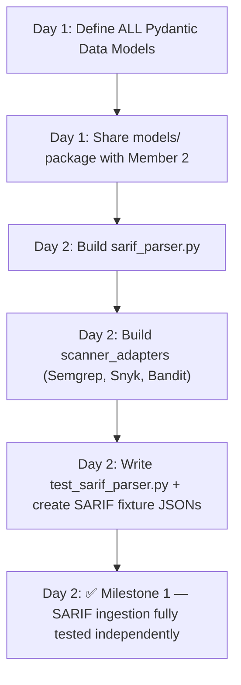
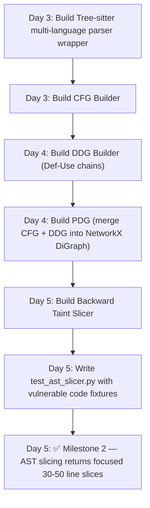
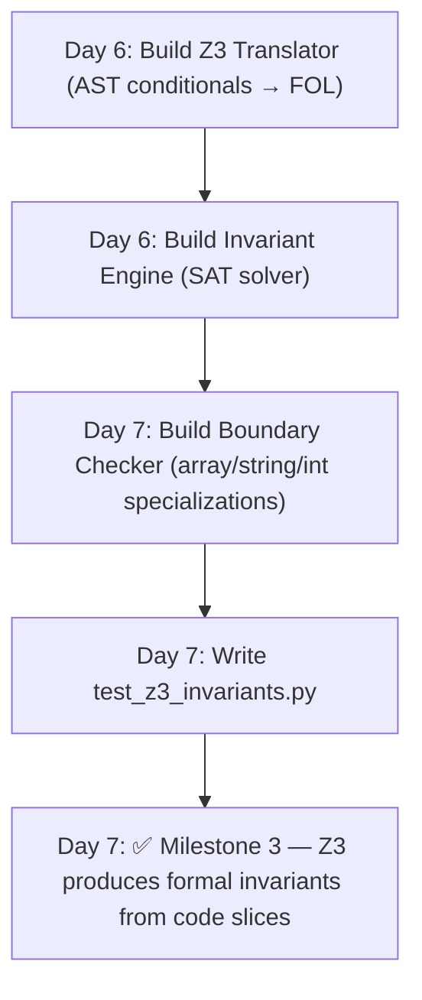
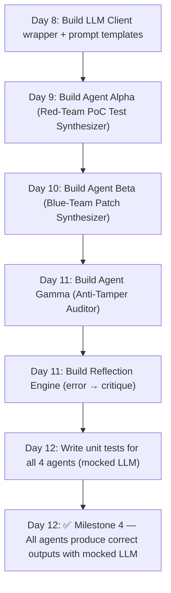
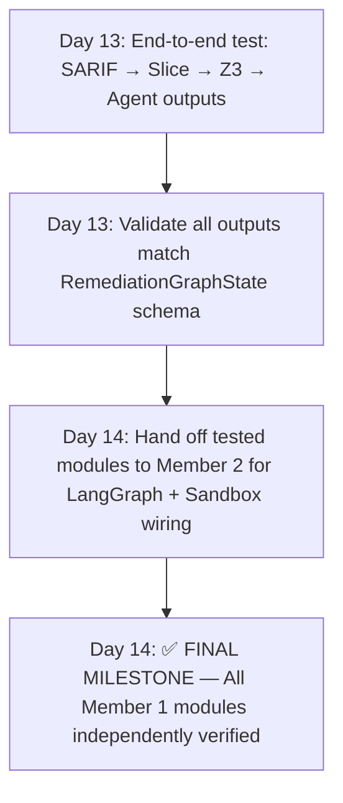

# PatchForge AI — Member 1 Task Assignment
## 🧠 Role: Code Analysis & AI Intelligence Engine (The Brain)
**Assigned To:** Member 1  
**Ownership:** SARIF Ingestion, AST/PDG Slicing, Z3 Formal Verification, AI Agents (Alpha, Beta, Gamma), Prompt Engineering, **AWS Bedrock LLM Integration**  
**Independence:** This workstream has **ZERO dependency** on Member 2. All outputs are pure data structures (`dict`, Pydantic models, `str` diffs). Member 1 tests everything using local Python unit tests with mock/fixture inputs — no Docker, no Git API, no CLI needed.

---

## 1. Responsibility Summary

```
┌──────────────────────────────────────────────────────────────────────┐
│                    MEMBER 1 — OWNERSHIP BOUNDARY                     │
│                                                                      │
│  ┌──────────────┐    ┌──────────────┐    ┌──────────────────┐       │
│  │ SARIF Parser  │───►│ AST & PDG    │───►│ Z3 SMT Formal    │       │
│  │ & Ingestion   │    │ Taint Slicer │    │ Invariant Engine │       │
│  └──────────────┘    └──────────────┘    └──────────────────┘       │
│         │                    │                      │                │
│         ▼                    ▼                      ▼                │
│  ┌──────────────────────────────────────────────────────────────┐   │
│  │            AI AGENT LAYER (LLM Prompt Chains)                │   │
│  │  ┌─────────────┐  ┌──────────────┐  ┌───────────────────┐   │   │
│  │  │ Agent Alpha  │  │ Agent Beta   │  │ Agent Gamma       │   │   │
│  │  │ (Red-Team    │  │ (Blue-Team   │  │ (Anti-Tamper      │   │   │
│  │  │  Test Synth) │  │  Patch Synth)│  │  Diff Auditor)    │   │   │
│  │  └─────────────┘  └──────────────┘  └───────────────────┘   │   │
│  │                                                              │   │
│  │  ┌──────────────┐  ┌──────────────────────────┐              │   │
│  │  │ Reflection   │  │ Shared Data Models &     │              │   │
│  │  │ & Critique   │  │ Interface Contracts       │              │   │
│  │  └──────────────┘  └──────────────────────────┘              │   │
│  └──────────────────────────────────────────────────────────────┘   │
└──────────────────────────────────────────────────────────────────────┘
```

---

## 2. Complete File List (All Files Member 1 Must Create)

Member 1 is responsible for generating **every file** listed below. Each file's purpose, inputs, outputs, and key classes/functions are described.

### 2.1 Shared Data Models (Interface Contract — Built FIRST)

> [!IMPORTANT]
> This is the **integration contract** between Member 1 and Member 2. Both members agree on these Pydantic models on Day 1. Member 2 will import these models directly. Member 1 owns and creates the file.

| # | File Path | Purpose |
|---|-----------|---------|
| 1 | `src/patchforge/models/__init__.py` | Package init, re-exports all models |
| 2 | `src/patchforge/models/vulnerability.py` | `VulnerabilityReport`, `VulnerabilityLocation`, `SARIFFinding` models |
| 3 | `src/patchforge/models/slicing.py` | `ASTContextSlice`, `PDGNode`, `SlicingResult` models |
| 4 | `src/patchforge/models/formal.py` | `FormalInvariant`, `Z3VerificationResult`, `BoundaryConstraint` models |
| 5 | `src/patchforge/models/agents.py` | `TestArtifact`, `PatchCandidate`, `AuditVerdict`, `ReflectionFeedback` models |
| 6 | `src/patchforge/models/sandbox.py` | `SandboxResult`, `MutationReport`, `DeltaSASTReport` models |
| 7 | `src/patchforge/models/state.py` | `RemediationGraphState` TypedDict — the central LangGraph state schema |

### 2.2 Subsystem 1: SARIF Ingestion & Parsing

| # | File Path | Purpose |
|---|-----------|---------|
| 8 | `src/patchforge/ingestion/__init__.py` | Package init |
| 9 | `src/patchforge/ingestion/sarif_parser.py` | Core SARIF v2.1.0 JSON schema validator and normalizer |
| 10 | `src/patchforge/ingestion/scanner_adapters/__init__.py` | Scanner adapter package init |
| 11 | `src/patchforge/ingestion/scanner_adapters/semgrep.py` | Semgrep-specific SARIF field extractor |
| 12 | `src/patchforge/ingestion/scanner_adapters/snyk.py` | Snyk-specific SARIF field extractor |
| 13 | `src/patchforge/ingestion/scanner_adapters/bandit.py` | Bandit-specific SARIF field extractor |

### 2.3 Subsystem 2: Tree-sitter AST & PDG Slicing

| # | File Path | Purpose |
|---|-----------|---------|
| 14 | `src/patchforge/slicing/__init__.py` | Package init |
| 15 | `src/patchforge/slicing/parser.py` | Tree-sitter multi-language wrapper (Python, JS/TS, Go, Java, Rust) |
| 16 | `src/patchforge/slicing/cfg_builder.py` | Control Flow Graph (CFG) generator from AST |
| 17 | `src/patchforge/slicing/ddg_builder.py` | Data Dependence Graph (DDG) / Def-Use chain builder |
| 18 | `src/patchforge/slicing/pdg.py` | Program Dependence Graph — merges CFG + DDG into unified NetworkX DiGraph |
| 19 | `src/patchforge/slicing/backward_slice.py` | Backward taint slicing: extracts minimal code slice from sink to source |

### 2.4 Subsystem 3: Z3 SMT Formal Invariant Engine

| # | File Path | Purpose |
|---|-----------|---------|
| 20 | `src/patchforge/formal/__init__.py` | Package init |
| 21 | `src/patchforge/formal/z3_translator.py` | Converts AST conditional nodes into Z3 First-Order Logic expressions |
| 22 | `src/patchforge/formal/invariant_engine.py` | Runs Z3 satisfiability checks and extracts counterexample invariants |
| 23 | `src/patchforge/formal/boundary_checker.py` | Specialized prover for array bounds, string lengths, integer overflow |

### 2.5 Subsystem 4: AI Agent Logic (Prompt Chains + Business Logic)

| # | File Path | Purpose |
|---|-----------|---------|
| 24 | `src/patchforge/agents/__init__.py` | Package init |
| 25 | `src/patchforge/agents/prompts.py` | All versioned, structured LLM system & user prompts |
| 26 | `src/patchforge/agents/llm_client.py` | Unified LLM API wrapper (Claude direct API + **AWS Bedrock**) with retry & token tracking |
| 27 | `src/patchforge/agents/bedrock_client.py` | **AWS Bedrock** inference wrapper — invokes Claude 3.5 Sonnet via `bedrock-runtime` API |
| 28 | `src/patchforge/agents/test_synthesizer.py` | **Agent Alpha** — Red-Team: generates PoC reproduction security tests |
| 29 | `src/patchforge/agents/patch_synthesizer.py` | **Agent Beta** — Blue-Team: generates minimal unified diff patches |
| 30 | `src/patchforge/agents/auditor.py` | **Agent Gamma** — Anti-Tamper: validates diff doesn't touch tests/configs |
| 31 | `src/patchforge/agents/reflection.py` | Reflection engine: parses sandbox stderr/traces into actionable critique |

### 2.6 Test Fixtures & Unit Tests

| # | File Path | Purpose |
|---|-----------|---------|
| 32 | `tests/fixtures/sarif/semgrep_cwe89_sqli.sarif.json` | Sample Semgrep SARIF for SQL Injection (CWE-89) |
| 33 | `tests/fixtures/sarif/bandit_cwe22_path_traversal.sarif.json` | Sample Bandit SARIF for Path Traversal (CWE-22) |
| 34 | `tests/fixtures/sarif/snyk_cwe79_xss.sarif.json` | Sample Snyk SARIF for Cross-Site Scripting (CWE-79) |
| 35 | `tests/fixtures/repositories/vulnerable_flask_app/app.py` | Intentionally vulnerable Flask app (SQL injection sink) |
| 36 | `tests/fixtures/repositories/vulnerable_flask_app/requirements.txt` | Dependencies for test fixture app |
| 37 | `tests/fixtures/repositories/vulnerable_express_app/server.js` | Intentionally vulnerable Express.js app (path traversal) |
| 38 | `tests/unit/test_sarif_parser.py` | Unit tests for SARIF parsing and normalization |
| 39 | `tests/unit/test_ast_slicer.py` | Unit tests for Tree-sitter parsing and PDG slicing |
| 40 | `tests/unit/test_z3_invariants.py` | Unit tests for Z3 formal invariant generation |
| 41 | `tests/unit/test_bedrock_client.py` | Unit tests for **AWS Bedrock** client (`boto3` mocked) |
| 42 | `tests/unit/test_agent_alpha.py` | Unit tests for Agent Alpha test synthesis (mocked LLM) |
| 43 | `tests/unit/test_agent_beta.py` | Unit tests for Agent Beta patch synthesis (mocked LLM) |
| 44 | `tests/unit/test_agent_gamma.py` | Unit tests for Agent Gamma anti-tamper auditing |
| 45 | `tests/unit/test_reflection.py` | Unit tests for reflection/critique error parsing |

**Total files owned by Member 1: 45**

---

## 3. Step-by-Step Working Flow

### Phase 1: Foundation (Day 1–2) — Shared Models + SARIF Ingestion



#### Phase 1 — Detailed Steps

**Step 1.1: Create the Shared Data Models Package (`models/`)**
```
Files to create:
  src/patchforge/models/__init__.py
  src/patchforge/models/vulnerability.py
  src/patchforge/models/slicing.py
  src/patchforge/models/formal.py
  src/patchforge/models/agents.py
  src/patchforge/models/sandbox.py
  src/patchforge/models/state.py
```
- Define every Pydantic `BaseModel` and `TypedDict` that BOTH members will use.
- This is the **integration contract**. Once both agree on the schema, they work independently.
- Key model: `RemediationGraphState` — the central dict flowing through the entire LangGraph state machine.

**Step 1.2: Build SARIF Parser**
```
File: src/patchforge/ingestion/sarif_parser.py

Input:  Raw SARIF JSON file path (str)
Output: List[VulnerabilityReport]

Key functions:
  - parse_sarif_file(file_path: str) -> List[VulnerabilityReport]
  - validate_sarif_schema(raw: dict) -> bool
  - extract_findings(sarif: dict) -> List[SARIFFinding]
  - normalize_location(location: dict) -> VulnerabilityLocation
```

**Step 1.3: Build Scanner Adapters**
```
Files:
  src/patchforge/ingestion/scanner_adapters/semgrep.py
  src/patchforge/ingestion/scanner_adapters/snyk.py
  src/patchforge/ingestion/scanner_adapters/bandit.py

Each adapter:
  Input:  Raw scanner-specific SARIF dict
  Output: Standardized VulnerabilityReport

Key class in each:
  class SemgrepAdapter:   def normalize(self, sarif: dict) -> List[VulnerabilityReport]
  class SnykAdapter:      def normalize(self, sarif: dict) -> List[VulnerabilityReport]
  class BanditAdapter:    def normalize(self, sarif: dict) -> List[VulnerabilityReport]
```

**Step 1.4: Create SARIF Fixtures + Unit Tests**
```
Fixture files:
  tests/fixtures/sarif/semgrep_cwe89_sqli.sarif.json
  tests/fixtures/sarif/bandit_cwe22_path_traversal.sarif.json
  tests/fixtures/sarif/snyk_cwe79_xss.sarif.json

Test file:
  tests/unit/test_sarif_parser.py

Test cases:
  - test_valid_sarif_parses_correctly()
  - test_invalid_sarif_raises_validation_error()
  - test_semgrep_adapter_normalization()
  - test_snyk_adapter_normalization()
  - test_bandit_adapter_normalization()
  - test_cwe_id_extraction()
  - test_physical_location_mapping()
```

---

### Phase 2: AST Slicing Engine (Day 3–5)



#### Phase 2 — Detailed Steps

**Step 2.1: Tree-sitter Parser Wrapper**
```
File: src/patchforge/slicing/parser.py

Input:  source_code (str), language (str: "python" | "javascript" | "go" | "java" | "rust")
Output: tree_sitter.Tree (parsed AST root node)

Key class:
  class MultiLanguageParser:
      def __init__(self, language: str)
      def parse(self, code: str) -> Tree
      def get_node_at_position(self, tree: Tree, line: int, col: int) -> Node
      def extract_function_body(self, tree: Tree, func_name: str) -> str
```

**Step 2.2: Control Flow Graph Builder**
```
File: src/patchforge/slicing/cfg_builder.py

Input:  Tree-sitter AST root Node
Output: networkx.DiGraph (nodes = statements, edges = control flow)

Key class:
  class CFGBuilder:
      def build(self, root_node: Node) -> nx.DiGraph
      # Handles: if/elif/else, for, while, try/except, return, break, continue
```

**Step 2.3: Data Dependence Graph Builder**
```
File: src/patchforge/slicing/ddg_builder.py

Input:  Tree-sitter AST root Node
Output: networkx.DiGraph (edges = Def-Use variable chains)

Key class:
  class DDGBuilder:
      def build(self, root_node: Node) -> nx.DiGraph
      def get_definitions(self, node: Node) -> Set[str]   # Variables defined
      def get_uses(self, node: Node) -> Set[str]           # Variables used
      # Links every USE of variable `x` to the nearest preceding DEFINITION of `x`
```

**Step 2.4: Program Dependence Graph (Union)**
```
File: src/patchforge/slicing/pdg.py

Input:  CFG (nx.DiGraph), DDG (nx.DiGraph)
Output: Unified PDG (nx.DiGraph with both control + data edges)

Key class:
  class PDGBuilder:
      def build(self, cfg: nx.DiGraph, ddg: nx.DiGraph) -> nx.DiGraph
      # G = (V, E_control ∪ E_data)
```

**Step 2.5: Backward Taint Slicer**
```
File: src/patchforge/slicing/backward_slice.py

Input:  PDG (nx.DiGraph), sink_node_id (int), source_code (str)
Output: ASTContextSlice (minimal code + imports + enclosing signatures)

Key class:
  class BackwardTaintSlicer:
      def slice(self, pdg: nx.DiGraph, sink_id: int, full_code: str) -> ASTContextSlice
      # Uses nx.ancestors() to get all nodes reachable backwards from sink
      # Reduces 800+ line file to 30-50 focused lines
```

**Step 2.6: Unit Tests**
```
File: tests/unit/test_ast_slicer.py

Test cases:
  - test_python_function_parsing()
  - test_cfg_if_else_branching()
  - test_ddg_variable_def_use_chain()
  - test_pdg_merges_cfg_and_ddg()
  - test_backward_slice_extracts_minimal_context()
  - test_slice_preserves_import_statements()
  - test_1000_line_file_reduces_to_under_60_lines()
```

---

### Phase 3: Z3 Formal Invariant Engine (Day 6–7)



#### Phase 3 — Detailed Steps

**Step 3.1: Z3 Translator**
```
File: src/patchforge/formal/z3_translator.py

Input:  ASTContextSlice (containing if-conditions, array accesses, arithmetic)
Output: List of Z3 expressions (z3.BoolRef)

Key class:
  class Z3ASTTranslator:
      def translate_conditionals(self, slice: ASTContextSlice) -> List[z3.BoolRef]
      def translate_array_access(self, index_expr: str, array_len: str) -> z3.BoolRef
      def translate_string_length(self, var: str, max_len: int) -> z3.BoolRef
```

**Step 3.2: Invariant Engine**
```
File: src/patchforge/formal/invariant_engine.py

Input:  Z3 path conditions + safety assertions
Output: FormalInvariant (status, counterexample, required constraints)

Key class:
  class SMTInvariantVerifier:
      def verify(self, path_conds: List[z3.BoolRef], safety: z3.BoolRef) -> FormalInvariant
      # Checks: SAT(path_conditions ∧ ¬safety)
      # If SAT → violation possible → extract counterexample → emit invariant
```

**Step 3.3: Boundary Checker**
```
File: src/patchforge/formal/boundary_checker.py

Input:  Variable names, types, and boundary constraints from AST
Output: List[BoundaryConstraint]

Key class:
  class BoundaryChecker:
      def check_integer_overflow(self, var: str, bit_width: int) -> BoundaryConstraint
      def check_array_bounds(self, index_var: str, array_size: int) -> BoundaryConstraint
      def check_string_length(self, str_var: str, max_len: int) -> BoundaryConstraint
```

---

### Phase 4: AI Agents (Day 8–12)



#### Phase 4 — Detailed Steps

**Step 4.1: LLM Client Wrapper**
```
File: src/patchforge/agents/llm_client.py

Purpose: Unified interface to call Claude 3.5 Sonnet or DeepSeek-Coder-V2
Input:  System prompt (str), user message (str), model config
Output: LLM response text (str)

Key class:
  class LLMClient:
      def __init__(self, provider: str, api_key: str, model: str)
      def generate(self, system: str, user: str, temperature: float = 0.1) -> str
      def generate_with_retry(self, ..., max_retries: int = 3) -> str
      # Tracks: token usage, latency, cost per call
```

**Step 4.2: Prompt Templates**
```
File: src/patchforge/agents/prompts.py

Contains ALL structured prompts:
  - AGENT_ALPHA_SYSTEM_PROMPT: Instructions for generating PoC reproduction tests
  - AGENT_ALPHA_USER_TEMPLATE: Fills in CWE-ID, slice code, sink info
  - AGENT_BETA_SYSTEM_PROMPT: Instructions for generating minimal unified diffs
  - AGENT_BETA_USER_TEMPLATE: Fills in slice, Z3 invariants, PoC test spec
  - AGENT_GAMMA_SYSTEM_PROMPT: Instructions for auditing diffs against tampering rules
  - REFLECTION_CRITIQUE_TEMPLATE: Formats sandbox stderr into actionable feedback
```

**Step 4.3: Agent Alpha — Security Test Synthesizer (Red Team)**
```
File: src/patchforge/agents/test_synthesizer.py

Input:  VulnerabilityReport, ASTContextSlice, CWE classification
Output: TestArtifact (standalone test file: test_cwe_reproduction.py)

Key class:
  class TestSynthesizerAgent:
      def synthesize(self, vuln: VulnerabilityReport, slice: ASTContextSlice) -> TestArtifact
      # Generates attack payloads: SQL injection strings, path traversal, overflow data
      # Output test MUST fail on unpatched code and PASS (defend) on patched code
```

**Step 4.4: Agent Beta — Patch Synthesizer (Blue Team)**
```
File: src/patchforge/agents/patch_synthesizer.py

Input:  ASTContextSlice, FormalInvariant, TestArtifact (from Alpha), optional ReflectionFeedback
Output: PatchCandidate (unified diff string)

Key class:
  class PatchSynthesizerAgent:
      def synthesize(self, slice: ASTContextSlice, invariants: FormalInvariant,
                     poc_test: TestArtifact, feedback: Optional[ReflectionFeedback] = None) -> PatchCandidate
      # Generates minimal git unified diff (not full file replacement)
      # Respects Z3 invariants as non-negotiable constraints
```

**Step 4.5: Agent Gamma — Anti-Tamper Auditor**
```
File: src/patchforge/agents/auditor.py

Input:  PatchCandidate (unified diff), ASTContextSlice (allowed modification boundary)
Output: AuditVerdict (approved: bool, violations: List[str])

Key class:
  class AntiTamperAuditor:
      def audit(self, patch: PatchCandidate, allowed_slice: ASTContextSlice) -> AuditVerdict
      # REJECTS if diff:
      #   - Modifies or deletes any file in tests/ directory
      #   - Removes assertion statements
      #   - Modifies .semgrep.yml, .bandit, or any scanner config
      #   - Touches lines OUTSIDE the computed AST slice boundary
```

**Step 4.6: Reflection Engine**
```
File: src/patchforge/agents/reflection.py

Input:  SandboxResult (exit_code, stderr, failed_tests)
Output: ReflectionFeedback (structured critique for Agent Beta's next iteration)

Key class:
  class ReflectionEngine:
      def critique(self, sandbox_result: SandboxResult, iteration: int) -> ReflectionFeedback
      # Parses: Python tracebacks, compiler errors, linter warnings, test assertion failures
      # Formats into: "Line X failed because Y. The fix should Z."
```

---

### Phase 5: Integration Testing & Handoff (Day 13–14)



---

## 4. Technology Stack (Member 1 Only)

| Library | Version | Purpose |
|---------|---------|---------|
| `tree-sitter` | ≥0.22 | Core AST parser engine |
| `tree-sitter-languages` | ≥1.10 | Pre-built grammars (Python, JS, Go, Java, Rust) |
| `networkx` | ≥3.2 | Graph construction for CFG, DDG, PDG |
| `z3-solver` | ≥4.12 | Microsoft Z3 theorem prover (Python API) |
| `pydantic` | ≥2.5 | Data model validation and serialization |
| `boto3` | ≥1.34 | **AWS SDK for Python** — AWS Bedrock Runtime client (`bedrock-runtime`) |
| `botocore` | ≥1.34 | AWS low-level client configuration and error handling |
| `anthropic` | ≥0.39 | Direct Claude API client (fallback when not using Bedrock) |
| `openai` | ≥1.50 | DeepSeek-Coder API client (OpenAI-compatible) |
| `pytest` | ≥8.0 | Unit testing framework |
| `pytest-mock` | ≥3.14 | LLM / AWS Bedrock call mocking for agent unit tests |

**Install command:**
```bash
pip install tree-sitter tree-sitter-languages networkx z3-solver pydantic boto3 botocore anthropic openai pytest pytest-mock
```

---

## 4.1 🎃 Halloween Theme Touchpoints for Member 1

While Member 2 builds the React UI and CSS styles, **Member 1 formats all data and prompts with Halloween-compatible metadata** so that Member 2's UI can render them seamlessly:
- **Severity Tagging:** All SARIF findings are mapped to a spooky skull score (`1_skull` to `5_skulls`) inside `VulnerabilityLocation`.
- **Status Enum:** State statuses use Halloween-aligned descriptors: `AWAKENING` (init), `DISSECTING` (slicing), `CONJURING` (Z3 proof), `DUELING` (adversarial agents), `TOMBSTONE_READY` (passed), `HAUNTED_FAIL` (escalated).
- **Vulnerability RIP Certificate:** In `prompts.py`, Agent Beta and Alpha templates generate a "Tombstone Inscription" summary (e.g., `⚰️ R.I.P. CWE-89 (SQL Injection) — Neutralized by PatchForge on YYYY-MM-DD`). This is displayed on Member 2's Graveyard page!

---

## 5. How to Test Everything Independently (No Docker / No Git API Needed)

Member 1 can verify **every single module** using only local Python:

```bash
# Run ALL Member 1 unit tests
pytest tests/unit/test_sarif_parser.py -v
pytest tests/unit/test_ast_slicer.py -v
pytest tests/unit/test_z3_invariants.py -v
pytest tests/unit/test_bedrock_client.py -v  # AWS Bedrock mock tests
pytest tests/unit/test_agent_alpha.py -v    # LLM calls mocked
pytest tests/unit/test_agent_beta.py -v     # LLM calls mocked
pytest tests/unit/test_agent_gamma.py -v    # Pure logic, no LLM
pytest tests/unit/test_reflection.py -v     # Pure parsing, no LLM

# Run all at once
pytest tests/unit/ -v --tb=short
```

### Quick Smoke Test (End-to-End without Sandbox):
```python
from patchforge.ingestion.sarif_parser import parse_sarif_file
from patchforge.slicing.backward_slice import BackwardTaintSlicer
from patchforge.formal.invariant_engine import SMTInvariantVerifier

# 1. Parse SARIF
vulns = parse_sarif_file("tests/fixtures/sarif/semgrep_cwe89_sqli.sarif.json")
print(f"Found {len(vulns)} vulnerabilities")

# 2. Slice code
slicer = BackwardTaintSlicer("python")
source = open(vulns[0].file_path).read()
slice_result = slicer.slice_from_location(source, vulns[0].start_line, vulns[0].sink_symbol)
print(f"Sliced {len(source.splitlines())} lines → {len(slice_result.slice_code.splitlines())} lines")

# 3. Generate invariants
verifier = SMTInvariantVerifier()
invariants = verifier.verify_from_slice(slice_result)
print(f"Z3 invariants: {invariants.required_invariants}")
```

---

## 6. Interface Contract with Member 2

Member 1 exposes the following **function signatures** that Member 2's LangGraph nodes will call:

```python
# ═══════════════ SARIF INGESTION ═══════════════
from patchforge.ingestion.sarif_parser import parse_sarif_file
vulns: List[VulnerabilityReport] = parse_sarif_file("path/to/report.sarif")

# ═══════════════ AST SLICING ═══════════════
from patchforge.slicing.backward_slice import BackwardTaintSlicer
slicer = BackwardTaintSlicer(language="python")
ast_slice: ASTContextSlice = slicer.slice_from_location(source_code, line, sink_symbol)

# ═══════════════ Z3 INVARIANTS ═══════════════
from patchforge.formal.invariant_engine import SMTInvariantVerifier
verifier = SMTInvariantVerifier()
invariants: FormalInvariant = verifier.verify_from_slice(ast_slice)

# ═══════════════ AGENT ALPHA ═══════════════
from patchforge.agents.test_synthesizer import TestSynthesizerAgent
agent_alpha = TestSynthesizerAgent(llm_client)
poc_test: TestArtifact = agent_alpha.synthesize(vuln, ast_slice)

# ═══════════════ AGENT BETA ═══════════════
from patchforge.agents.patch_synthesizer import PatchSynthesizerAgent
agent_beta = PatchSynthesizerAgent(llm_client)
patch: PatchCandidate = agent_beta.synthesize(ast_slice, invariants, poc_test, feedback=None)

# ═══════════════ AGENT GAMMA ═══════════════
from patchforge.agents.auditor import AntiTamperAuditor
auditor = AntiTamperAuditor()
verdict: AuditVerdict = auditor.audit(patch, ast_slice)

# ═══════════════ REFLECTION ═══════════════
from patchforge.agents.reflection import ReflectionEngine
reflector = ReflectionEngine()
feedback: ReflectionFeedback = reflector.critique(sandbox_result, iteration=1)
```

> [!TIP]
> Member 2 imports and calls these functions inside LangGraph node functions. Member 1 never needs to know about Docker, Git APIs, or the CLI.

---

## 7. Key Deliverable Checklist

- [ ] `models/` package — All 7 Pydantic model files (shared contract) with Halloween metadata support
- [ ] `ingestion/` package — SARIF parser + 3 scanner adapters (with skull severity rating)
- [ ] `slicing/` package — Parser, CFG, DDG, PDG, Backward Slicer (5 files)
- [ ] `formal/` package — Z3 translator, invariant engine, boundary checker (3 files)
- [ ] `agents/` package — Prompts, LLM client, **AWS Bedrock client**, Alpha, Beta, Gamma, Reflection (8 files)
- [ ] Test fixtures — 3 SARIF JSONs + 2 vulnerable app directories
- [ ] Unit tests — 8 test files covering all subsystems including AWS Bedrock
- [ ] Smoke test script validating end-to-end SARIF → Slice → Z3 → AWS Bedrock/Agent chain

