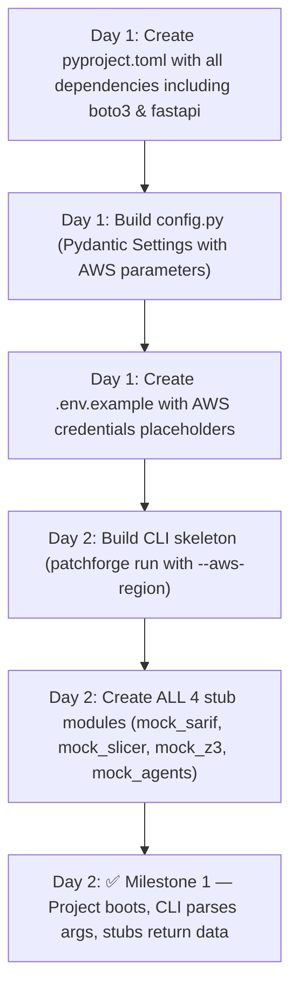
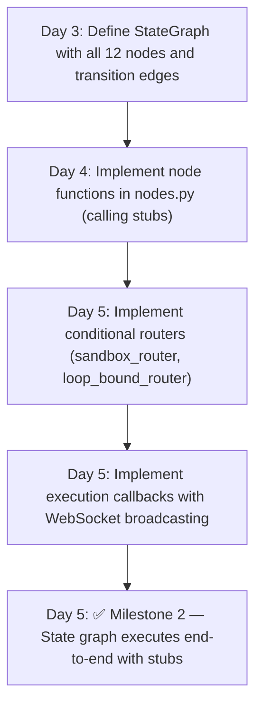
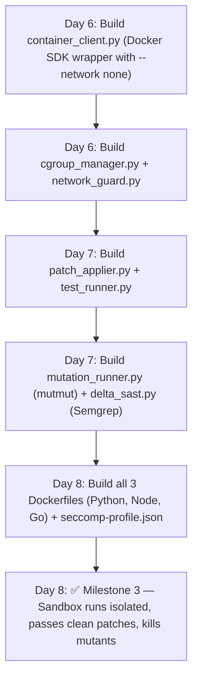
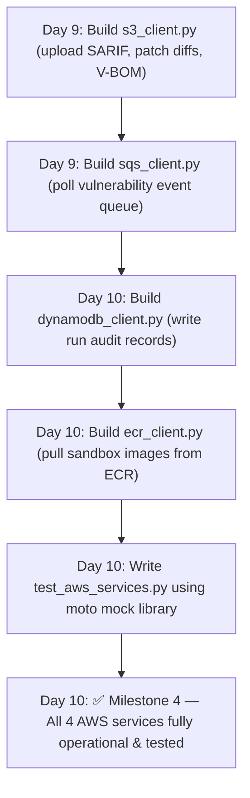
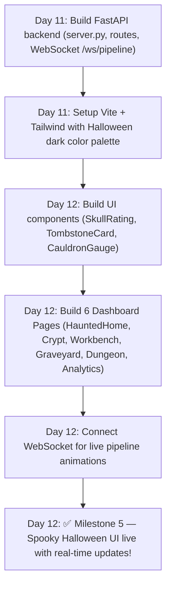
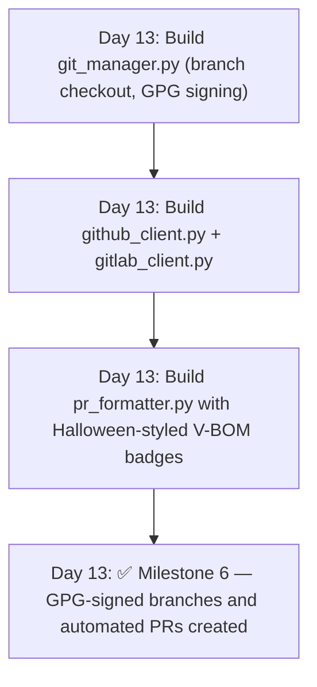
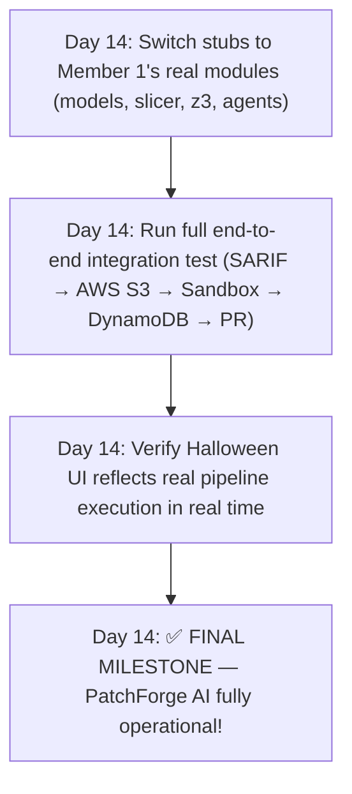

# PatchForge AI — Member 2 Task Assignment
## ⚙️ Role: Execution Infrastructure, AWS Cloud Integration & Halloween UI Dashboard (The Body & Face)
**Assigned To:** Member 2  
**Ownership:** LangGraph State Machine, Docker Sandbox, Mutation Testing, Delta-SAST, Git/PR Delivery, CLI, Configuration, **AWS Cloud Services (S3, SQS, DynamoDB, ECR)**, and the **🎃 Halloween-Themed Operations Dashboard (React + Vite + TailwindCSS + FastAPI)**.  
**Independence:** This workstream has **ZERO dependency** on Member 1 during development. Member 2 uses **mock/stub implementations** for all code analysis functions (SARIF parser, slicer, Z3, agents) and tests the full execution, AWS, and UI pipeline independently. At integration time, stubs are replaced with Member 1's real implementations via simple imports.

---

## 1. Responsibility Summary

```
┌──────────────────────────────────────────────────────────────────────────────┐
│                        MEMBER 2 — OWNERSHIP BOUNDARY                         │
│                                                                              │
│  ┌────────────────────────────────────────────────────────────────────────┐  │
│  │              🎃 HALLOWEEN-THEMED OPERATIONS DASHBOARD                  │  │
│  │  ┌──────────────┐  ┌─────────────┐  ┌──────────────┐  ┌─────────────┐  │  │
│  │  │ Haunted Home │  │ Vuln Crypt  │  │ Patch Bench  │  │  Graveyard  │  │  │
│  │  │ (Overview)   │  │ (Active)    │  │ (Live State) │  │  (R.I.P.)   │  │  │
│  │  └──────────────┘  └─────────────┘  └──────────────┘  └─────────────┘  │  │
│  │  ┌──────────────────────────────────────────────────────────────────┐  │  │
│  │  │ FastAPI Server (WebSocket + REST endpoints)                      │  │  │
│  │  └──────────────────────────────────────────────────────────────────┘  │  │
│  └────────────────────────────────────────────────────────────────────────┘  │
│                                      │                                       │
│                                      ▼                                       │
│  ┌────────────────────────────────────────────────────────────────────────┐  │
│  │                     AWS CLOUD INTEGRATION LAYER                        │  │
│  │  ┌──────────────┐  ┌─────────────┐  ┌──────────────┐  ┌─────────────┐  │  │
│  │  │  Amazon S3   │  │ Amazon SQS  │  │  DynamoDB    │  │ Amazon ECR  │  │  │
│  │  │ (Artifacts)  │  │(Event Queue)│  │ (Audit Trail)│  │(Image Repo) │  │  │
│  │  └──────────────┘  └─────────────┘  └──────────────┘  └─────────────┘  │  │
│  └────────────────────────────────────────────────────────────────────────┘  │
│                                      │                                       │
│                                      ▼                                       │
│  ┌────────────────────────────────────────────────────────────────────────┐  │
│  │              LANGGRAPH STATE MACHINE (Central Orchestrator)            │  │
│  │  [Ingest] ──► [Slice] ──► [Z3 Solve] ──► [Agents] ──► [Router Loop]    │  │
│  └────────────────────────────────────────────────────────────────────────┘  │
│                                      │                                       │
│                                      ▼                                       │
│  ┌────────────────────────────────────────────────────────────────────────┐  │
│  │           HERMETIC DOCKER SANDBOX (Zero-Trust Execution)               │  │
│  │  ┌──────────────┐  ┌─────────────┐  ┌──────────────┐  ┌─────────────┐  │  │
│  │  │ Container    │  │ Test Runner │  │ Mutation     │  │ Delta-SAST  │  │  │
│  │  │ Manager      │  │ (pytest)    │  │ Harness      │  │ Re-Scanner  │  │  │
│  │  └──────────────┘  └─────────────┘  └──────────────┘  └─────────────┘  │  │
│  └────────────────────────────────────────────────────────────────────────┘  │
│                                      │                                       │
│                                      ▼                                       │
│  ┌────────────────────────────────────────────────────────────────────────┐  │
│  │          VCS DELIVERY, GPG SIGNING & AUTOMATED PULL REQUESTS           │  │
│  └────────────────────────────────────────────────────────────────────────┘  │
└──────────────────────────────────────────────────────────────────────────────┘
```

---

## 2. Complete File List (All Files Member 2 Must Create)

Member 2 is responsible for generating **every file** listed below.

### 2.1 Project Bootstrap, Configuration & CLI

| # | File Path | Purpose |
|---|-----------|---------|
| 1 | `src/patchforge/__init__.py` | Root package init (version, top-level exports) |
| 2 | `src/patchforge/config.py` | Pydantic Settings: env vars, AWS credentials/regions, Docker config, defaults |
| 3 | `pyproject.toml` | Poetry / Hatch build configuration with all production & dev dependencies |
| 4 | `requirements.txt` | Locked production dependency versions |
| 5 | `.env.example` | Example environment variable file (AWS keys, GitHub token, Docker socket) |
| 6 | `src/patchforge/cli.py` | Typer/Click CLI: `patchforge run`, `patchforge status`, `--aws-region`, `--auto-pr` |

### 2.2 AWS Cloud Services Layer (AWS Integration Requirement)

| # | File Path | Purpose |
|---|-----------|---------|
| 7 | `src/patchforge/aws/__init__.py` | Package init |
| 8 | `src/patchforge/aws/s3_client.py` | **Amazon S3** client: uploads/downloads raw SARIF, patch diffs, test logs, V-BOM |
| 9 | `src/patchforge/aws/sqs_client.py` | **Amazon SQS** client: polls incoming vulnerability event queue from CI scanners |
| 10 | `src/patchforge/aws/dynamodb_client.py` | **Amazon DynamoDB** client: writes/queries remediation run audit trails & MTTR logs |
| 11 | `src/patchforge/aws/ecr_client.py` | **Amazon ECR** client: pulls hardened sandbox runtime container images |

### 2.3 Subsystem: LangGraph State Machine & Orchestrator

| # | File Path | Purpose |
|---|-----------|---------|
| 12 | `src/patchforge/orchestrator/__init__.py` | Package init |
| 13 | `src/patchforge/orchestrator/graph.py` | LangGraph `StateGraph` definition — all nodes, edges, conditional routers |
| 14 | `src/patchforge/orchestrator/nodes.py` | Node functions (ingest, slice, solve, synthesize, verify, dispatch) |
| 15 | `src/patchforge/orchestrator/routers.py` | Conditional edge functions (pass/fail/escalate branching logic) |
| 16 | `src/patchforge/orchestrator/callbacks.py` | Execution lifecycle callbacks (logging, telemetry, token tracking, WebSocket events) |

### 2.4 Subsystem: Hermetic Docker Sandbox

| # | File Path | Purpose |
|---|-----------|---------|
| 17 | `src/patchforge/sandbox/__init__.py` | Package init |
| 18 | `src/patchforge/sandbox/container_client.py` | Docker / Podman SDK wrapper: create, start, wait, collect logs, destroy |
| 19 | `src/patchforge/sandbox/cgroup_manager.py` | Memory (2GB), CPU (2 cores), PID (100) resource quota controller |
| 20 | `src/patchforge/sandbox/network_guard.py` | Air-gap verification: validates `--network none` is strictly active |
| 21 | `src/patchforge/sandbox/test_runner.py` | In-container test execution engine (pytest, npm test, cargo test, mvn test) |
| 22 | `src/patchforge/sandbox/mutation_runner.py` | Mutation testing harness: runs mutmut/stryker, collects mutation scores |
| 23 | `src/patchforge/sandbox/delta_sast.py` | In-sandbox static analysis re-scanner (Semgrep CLI) for post-patch verification |
| 24 | `src/patchforge/sandbox/patch_applier.py` | Applies `git diff` patches inside sandbox workspace, validates apply success |

### 2.5 Subsystem: VCS Integration & PR Delivery

| # | File Path | Purpose |
|---|-----------|---------|
| 25 | `src/patchforge/delivery/__init__.py` | Package init |
| 26 | `src/patchforge/delivery/git_manager.py` | Git operations: branch creation, worktree isolation, GPG commit signing |
| 27 | `src/patchforge/delivery/github_client.py` | GitHub REST/GraphQL API: create PR, add labels, attach review comments |
| 28 | `src/patchforge/delivery/gitlab_client.py` | GitLab REST API: create MR, add labels, attach notes |
| 29 | `src/patchforge/delivery/pr_formatter.py` | Rich Markdown PR body generator with Verification Bill of Materials (V-BOM) |

### 2.6 Dashboard API Backend (FastAPI)

| # | File Path | Purpose |
|---|-----------|---------|
| 30 | `src/patchforge/api/__init__.py` | Package init |
| 31 | `src/patchforge/api/server.py` | FastAPI application factory, CORS setup, WebSocket mount |
| 32 | `src/patchforge/api/schemas.py` | Pydantic response models for dashboard metrics and runs |
| 33 | `src/patchforge/api/routes/__init__.py` | Routes package init |
| 34 | `src/patchforge/api/routes/dashboard.py` | `GET /api/dashboard` — summary metrics (skulls, cauldrons, ghosts) |
| 35 | `src/patchforge/api/routes/vulnerabilities.py` | `GET /api/vulns` — active vulnerability findings with skull ratings |
| 36 | `src/patchforge/api/routes/runs.py` | `GET /api/runs` — DynamoDB run history & tombstone records |
| 37 | `src/patchforge/api/routes/pipeline.py` | `WebSocket /ws/pipeline` — real-time state machine node transitions |

### 2.7 🎃 Halloween-Themed Dashboard Frontend (`dashboard/`)

| # | File Path | Purpose |
|---|-----------|---------|
| 38 | `dashboard/package.json` | React 18, Vite, TailwindCSS, Lucide-react, Chart.js dependencies |
| 39 | `dashboard/vite.config.js` | Vite build & proxy configuration (proxies `/api` to FastAPI) |
| 40 | `dashboard/tailwind.config.js` | Halloween theme color palette (midnight black, pumpkin orange, coffin purple) |
| 41 | `dashboard/public/index.html` | HTML entry point with Creepster & JetBrains Mono font imports |
| 42 | `dashboard/public/favicon-pumpkin.ico` | 🎃 Pumpkin favicon icon |
| 43 | `dashboard/public/assets/cobweb-texture.svg` | SVG background overlay with subtle cobweb pattern |
| 44 | `dashboard/public/assets/graveyard-hero.svg` | Animated SVG graveyard hero banner for overview page |
| 45 | `dashboard/public/assets/ghost-particle.svg` | Floating ghost particle animation sprite |
| 46 | `dashboard/src/index.jsx` | React root mounting point |
| 47 | `dashboard/src/App.jsx` | Root router with Halloween dark theme container |
| 48 | `dashboard/src/theme/halloween.js` | Spooky design tokens: colors, shadows, borders, font families |
| 49 | `dashboard/src/theme/animations.css` | Keyframes: ghost floating, cauldron bubbling, candle flicker, dripping blood |
| 50 | `dashboard/src/components/Sidebar.jsx` | Spooky navigation sidebar with cobweb borders & glowing pumpkin logo |
| 51 | `dashboard/src/components/SkullRating.jsx` | Severity component rendering 1 to 5 skull icons (💀) |
| 52 | `dashboard/src/components/TombstoneCard.jsx` | "R.I.P." tombstone component for remediated vulnerabilities in Graveyard |
| 53 | `dashboard/src/components/CauldronGauge.jsx` | Bubbling cauldron circular gauge for CPU, RAM, and mutation score |
| 54 | `dashboard/src/components/PipelineNode.jsx` | Animated state machine step (glowing orange when active, green on pass) |
| 55 | `dashboard/src/components/GhostParticles.jsx` | Ambient floating ghost canvas effect overlay |
| 56 | `dashboard/src/pages/HauntedHome.jsx` | 🏚️ Main overview: active skulls, cauldrons, bat animations, quick stats |
| 57 | `dashboard/src/pages/VulnCrypt.jsx` | 💀 Table of detected vulnerabilities with filters and MTTR timers |
| 58 | `dashboard/src/pages/PatchWorkbench.jsx` | 🔬 Real-time state machine live view connected via WebSocket |
| 59 | `dashboard/src/pages/Graveyard.jsx` | ⚰️ Archive of resolved CVEs displayed as tombstone cards |
| 60 | `dashboard/src/pages/SandboxDungeon.jsx` | 🧪 Live container telemetry: memory limits, air-gap status, test pass rates |
| 61 | `dashboard/src/pages/HauntedAnalytics.jsx` | 📊 Dark Halloween-themed charts: MTTR burn-down, patch success rate |
| 62 | `dashboard/src/services/api.js` | Axios/fetch REST client calling FastAPI backend |
| 63 | `dashboard/src/services/websocket.js` | WebSocket client with automatic reconnect for live pipeline telemetry |

### 2.8 Docker Images & Container Security

| # | File Path | Purpose |
|---|-----------|---------|
| 64 | `Dockerfile` | Main PatchForge orchestrator image (includes FastAPI + CLI) |
| 65 | `docker/runtimes/python-3.11.Dockerfile` | Ephemeral sandbox image for Python projects |
| 66 | `docker/runtimes/node-20.Dockerfile` | Ephemeral sandbox image for Node.js/TypeScript projects |
| 67 | `docker/runtimes/go-1.22.Dockerfile` | Ephemeral sandbox image for Go projects |
| 68 | `docker/seccomp-profile.json` | Restricted syscall allowlist profile for sandbox security |

### 2.9 CI/CD & Documentation

| # | File Path | Purpose |
|---|-----------|---------|
| 69 | `.github/workflows/ci.yml` | GitHub Actions CI: lint, type-check, unit tests, integration tests |
| 70 | `.github/workflows/security-audit.yml` | Self-SAST: runs Semgrep/Bandit on PatchForge's own codebase |
| 71 | `.github/pull_request_template.md` | PR template for PatchForge contributions |
| 72 | `README.md` | Comprehensive project README with setup instructions and architecture |
| 73 | `docs/THREAT_MODEL.md` | Full STRIDE threat model document |
| 74 | `docs/DEPLOYMENT_GUIDE.md` | Enterprise deployment guide (AWS, Kubernetes, CLI, Dashboard) |

### 2.10 Integration Stubs & Tests

| # | File Path | Purpose |
|---|-----------|---------|
| 75 | `src/patchforge/stubs/__init__.py` | Stub package init |
| 76 | `src/patchforge/stubs/mock_sarif_parser.py` | Returns hardcoded `VulnerabilityReport` matching Member 1's models |
| 77 | `src/patchforge/stubs/mock_slicer.py` | Returns hardcoded `ASTContextSlice` (35-line Python snippet) |
| 78 | `src/patchforge/stubs/mock_z3_engine.py` | Returns hardcoded `FormalInvariant` with sample boundary constraints |
| 79 | `src/patchforge/stubs/mock_agents.py` | Returns hardcoded `TestArtifact`, `PatchCandidate`, `AuditVerdict` |
| 80 | `tests/integration/__init__.py` | Package init |
| 81 | `tests/integration/test_langgraph_pipeline.py` | Full state graph execution test using stubs |
| 82 | `tests/integration/test_sandbox_execution.py` | Docker sandbox spin-up, patch apply, test run, teardown |
| 83 | `tests/integration/test_mutation_runner.py` | Mutation engine test with sample project |
| 84 | `tests/integration/test_aws_services.py` | **AWS tests** using `moto` (S3 upload/download, SQS poll, DynamoDB write) |
| 85 | `tests/integration/test_git_delivery.py` | Git branch creation, commit, GPG signing (local Git repo) |
| 86 | `tests/integration/test_pr_formatter.py` | PR Markdown generation with V-BOM content validation |
| 87 | `tests/integration/test_dashboard_api.py` | FastAPI TestClient tests for all REST & WebSocket routes |
| 88 | `tests/integration/test_end_to_end.py` | Full pipeline: S3 SARIF → (stubs) → Sandbox → DynamoDB → PR |

**Total files owned by Member 2: 88**

---

## 3. Step-by-Step Working Flow

### Phase 1: Project Bootstrap, AWS Configuration & Stubs (Day 1–2)



#### Detailed Steps:
1. **`pyproject.toml`**: Include `boto3`, `moto`, `docker`, `langgraph`, `fastapi`, `uvicorn`, `gitpython`, `PyGithub`, `typer`, `rich`, `pydantic-settings`.
2. **`config.py`**: Add AWS configuration fields:
   ```python
   aws_region: str = "us-east-1"
   aws_access_key_id: Optional[SecretStr] = None
   aws_secret_access_key: Optional[SecretStr] = None
   s3_artifact_bucket: str = "patchforge-artifacts"
   sqs_queue_url: Optional[str] = None
   dynamodb_table_name: str = "PatchForgeAuditTrail"
   ecr_repository_uri: Optional[str] = None
   ```
3. **Stubs Creation**: Create realistic mock objects in `src/patchforge/stubs/` using the shared Pydantic models from `src/patchforge/models/` created by Member 1.

---

### Phase 2: LangGraph Orchestrator (Day 3–5)



#### Detailed Steps:
- Wire the 8 stages into a compiled `StateGraph(RemediationGraphState)`.
- Use the 4 stubs so the state machine transitions cleanly: `ingest` → `slice` → `z3` → `synthesize` → `sandbox` → `verify` → `dispatch`.
- Hook `callbacks.py` to broadcast progress updates to the WebSocket server for the Halloween UI.

---

### Phase 3: Hermetic Docker Sandbox & Mutation Engine (Day 6–8)



#### Detailed Steps:
- Configure containers with `--network none`, rootless user `1001:1001`, `read_only=True`, 2GB RAM cap, and 2.0 CPU cap.
- Implement `SandboxTestRunner` to execute test suites and return `TestRunResult`.
- Implement `MutationTestRunner` to parse mutation kill scores against threshold ($\ge 85\%$).

---

### Phase 4: AWS Cloud Integration (Day 9–10)



#### Detailed Steps:
1. **`s3_client.py`**:
   - `upload_sarif(file_path: str, run_id: str) -> str`
   - `upload_patch_artifact(patch_diff: str, run_id: str) -> str`
   - `upload_vbom(vbom_json: str, run_id: str) -> str`
2. **`sqs_client.py`**:
   - `poll_vulnerability_events(max_messages: int = 5) -> List[dict]`
   - `delete_event(receipt_handle: str) -> None`
3. **`dynamodb_client.py`**:
   - `record_run(run_id: str, cwe_id: str, status: str, duration: float, pr_url: str) -> None`
   - `get_run_history(limit: int = 50) -> List[dict]`
   - `get_graveyard_records() -> List[dict]` (powers the Graveyard page)
4. **`ecr_client.py`**:
   - `pull_runtime_image(image_tag: str) -> str`
5. **AWS Mock Unit Tests**:
   - Use `@mock_aws` from `moto` to test all S3, SQS, and DynamoDB operations in `tests/integration/test_aws_services.py` without requiring active AWS credentials.

---

### Phase 5: 🎃 Halloween Dashboard UI & FastAPI Backend (Day 11–12)



#### 🎃 Detailed Design Tokens (`dashboard/src/theme/halloween.js`):
```javascript
export const halloweenTheme = {
  colors: {
    midnightBlack: '#0d0d0d',
    coffinPurple: '#1a0a2e',
    deepGrave: '#120720',
    pumpkinOrange: '#ff6b00',
    pumpkinGlow: '#ff8c33',
    bloodRed: '#8b0000',
    bloodVibrant: '#ff1a1a',
    ghostGreen: '#00ff88',
    slimeGreen: '#39ff14',
    cauldronYellow: '#ffd700',
    boneWhite: '#e0d8cc',
    cobwebGray: '#3a3440',
  },
  fonts: {
    heading: '"Creepster", cursive',
    mono: '"JetBrains Mono", monospace',
    body: '"Inter", sans-serif',
  }
};
```

#### Dashboard Pages Implemented:
1. **`HauntedHome.jsx`**: Overview cards (Active Skulls 💀, In-Progress Bats 🦇, Remediated Ghosts 👻), bubbling cauldron health gauge, live graveyard hero illustration.
2. **`VulnCrypt.jsx`**: Table of vulnerabilities, each with 1–5 skull severity rating (`<SkullRating count={vuln.skulls} />`), CWE link, and MTTR exposure clock.
3. **`PatchWorkbench.jsx`**: Interactive pipeline visualizer (`AST Slicing` ➔ `Z3 Solver` ➔ `Agent Synthesis` ➔ `Sandbox` ➔ `PR Dispatch`). Nodes pulsate with orange candle glow when active and flash green on pass.
4. **`Graveyard.jsx`**: Grid of tombstone cards (`<TombstoneCard />`) for remediated vulnerabilities with "R.I.P. CWE-89", date of remediation, and GitHub PR badge.
5. **`SandboxDungeon.jsx`**: Ephemeral container monitor with bubbling cauldron gauges for CPU/RAM and live test pass/fail streams.
6. **`HauntedAnalytics.jsx`**: Spooky dark-purple time-series charts showing MTTR reduction from 60 days to 3 minutes.

---

### Phase 6: VCS Delivery & PR Dispatch (Day 13)



---

### Phase 7: End-to-End Integration & Final Polish (Day 14)



---

## 4. Technology Stack (Member 2 Only)

| Category | Library | Version | Purpose |
|----------|---------|---------|---------|
| **AWS Cloud** | `boto3` | ≥1.34 | AWS SDK for Python (S3, SQS, DynamoDB, ECR) |
| **AWS Testing** | `moto[s3,sqs,dynamodb]` | ≥5.0 | Complete in-memory AWS mock suite for unit tests |
| **Orchestration**| `langgraph` | ≥0.2 | Stateful directed graph multi-agent orchestrator |
| **Orchestration**| `langchain-core` | ≥0.3 | State graph abstractions |
| **Container** | `docker` | ≥7.0 | Docker SDK for Python (hermetic container sandbox) |
| **Git / VCS** | `gitpython` | ≥3.1 | Programmatic Git operations, worktrees, GPG signing |
| **Git / VCS** | `PyGithub` | ≥2.1 | GitHub REST API client for PR creation |
| **CLI** | `typer` | ≥0.12 | CLI builder with rich terminal output |
| **CLI** | `rich` | ≥13.0 | Spooky colored terminal output & progress bars |
| **Backend API** | `fastapi` | ≥0.110 | REST & WebSocket API backend for dashboard |
| **Backend API** | `uvicorn` | ≥0.29 | High-performance ASGI web server |
| **Backend API** | `websockets`| ≥12.0 | Real-time bi-directional pipeline streaming |
| **Frontend** | `react` | ≥18.2 | Dashboard UI framework |
| **Frontend** | `vite` | ≥5.0 | Blazing fast frontend build tool & dev server |
| **Frontend** | `tailwindcss` | ≥3.4 | Utility-first CSS configured with Halloween palette |
| **Frontend** | `lucide-react`| ≥0.350 | Icons (skull, ghost, flame, shield, terminal) |
| **Testing** | `pytest` | ≥8.0 | Test runner |
| **Testing** | `pytest-asyncio` | ≥0.23 | Async tests for FastAPI and WebSockets |

**Install command (Python backend):**
```bash
pip install boto3 "moto[s3,sqs,dynamodb]" langgraph langchain-core docker gitpython PyGithub typer rich fastapi uvicorn websockets pydantic pydantic-settings pytest pytest-asyncio
```

**Install command (React dashboard):**
```bash
cd dashboard && npm install
```

---

## 5. How to Test Everything Independently

Member 2 can verify the **entire infrastructure, AWS integration, and Halloween UI** without waiting for Member 1:

```bash
# 1. Test LangGraph state machine with stubs
pytest tests/integration/test_langgraph_pipeline.py -v

# 2. Test Docker sandbox (requires Docker daemon)
pytest tests/integration/test_sandbox_execution.py -v

# 3. Test AWS Cloud Services (S3, SQS, DynamoDB mocked via moto — NO AWS account needed!)
pytest tests/integration/test_aws_services.py -v

# 4. Test FastAPI dashboard endpoints & WebSocket
pytest tests/integration/test_dashboard_api.py -v

# 5. Test Git delivery & PR formatter
pytest tests/integration/test_git_delivery.py -v
pytest tests/integration/test_pr_formatter.py -v

# 6. Run all tests at once
pytest tests/integration/ -v --timeout=120
```

### Launch the 🎃 Halloween Dashboard Locally:
```bash
# Terminal 1: Launch FastAPI Backend
uvicorn patchforge.api.server:app --host 0.0.0.0 --port 8000 --reload

# Terminal 2: Launch React Frontend
cd dashboard && npm run dev
# Open browser at: http://localhost:5173
```

---

## 6. Interface Contract with Member 1

Member 2 consumes Member 1's code through this clean interface. During development, Member 2 uses stubs:

```python
# In src/patchforge/orchestrator/nodes.py:
USE_STUBS = os.getenv("PATCHFORGE_USE_STUBS", "false").lower() == "true"

if USE_STUBS:
    from patchforge.stubs.mock_sarif_parser import parse_sarif_file
    from patchforge.stubs.mock_slicer import BackwardTaintSlicer
    from patchforge.stubs.mock_z3_engine import SMTInvariantVerifier
    from patchforge.stubs.mock_agents import TestSynthesizerAgent, PatchSynthesizerAgent, AntiTamperAuditor, ReflectionEngine
else:
    # Real implementations imported from Member 1:
    from patchforge.ingestion.sarif_parser import parse_sarif_file
    from patchforge.slicing.backward_slice import BackwardTaintSlicer
    from patchforge.formal.invariant_engine import SMTInvariantVerifier
    from patchforge.agents.test_synthesizer import TestSynthesizerAgent
    from patchforge.agents.patch_synthesizer import PatchSynthesizerAgent
    from patchforge.agents.auditor import AntiTamperAuditor
    from patchforge.agents.reflection import ReflectionEngine
```

---

## 7. Key Deliverable Checklist

- [ ] Project bootstrap: `config.py` (with AWS settings), `pyproject.toml`, `.env.example`, `cli.py`
- [ ] **AWS Cloud Integration (`src/patchforge/aws/`)**:
  - [ ] `s3_client.py` (SARIF, diffs, V-BOM persistence)
  - [ ] `sqs_client.py` (vulnerability event queue consumer)
  - [ ] `dynamodb_client.py` (audit trail & graveyard records)
  - [ ] `ecr_client.py` (sandbox container image pull)
- [ ] **LangGraph Orchestrator (`src/patchforge/orchestrator/`)**:
  - [ ] `graph.py`, `nodes.py`, `routers.py`, `callbacks.py` (with WebSocket broadcasting)
- [ ] **Hermetic Sandbox (`src/patchforge/sandbox/`)**:
  - [ ] `container_client.py`, `cgroup_manager.py`, `network_guard.py`, `test_runner.py`, `mutation_runner.py`, `delta_sast.py`, `patch_applier.py`
- [ ] **FastAPI Dashboard Backend (`src/patchforge/api/`)**:
  - [ ] `server.py`, `schemas.py`, and routes for dashboard, vulns, runs, WebSocket
- [ ] **🎃 Halloween Operations Dashboard (`dashboard/`)**:
  - [ ] React 18 + Vite setup with Halloween theme provider and Creepster font
  - [ ] Components: `SkullRating`, `TombstoneCard`, `CauldronGauge`, `PipelineNode`, `GhostParticles`
  - [ ] Pages: `HauntedHome`, `VulnCrypt`, `PatchWorkbench`, `Graveyard`, `SandboxDungeon`, `HauntedAnalytics`
- [ ] **VCS Integration (`src/patchforge/delivery/`)**:
  - [ ] `git_manager.py`, `github_client.py`, `gitlab_client.py`, `pr_formatter.py`
- [ ] Dockerfiles: Python, Node, Go sandbox runtimes + `seccomp-profile.json`
- [ ] Integration tests: 8 test files including `test_aws_services.py` and `test_dashboard_api.py`
- [ ] Documentation: `README.md`, `docs/DEPLOYMENT_GUIDE.md`, `docs/THREAT_MODEL.md`
