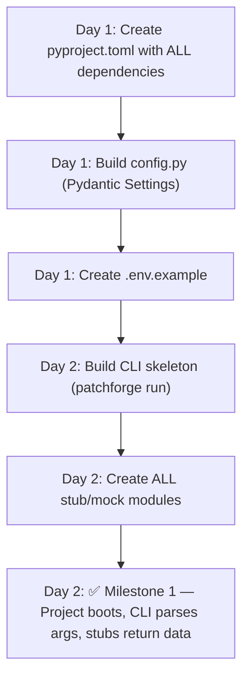
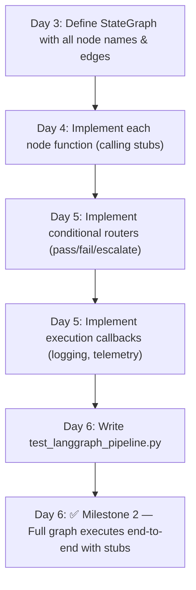
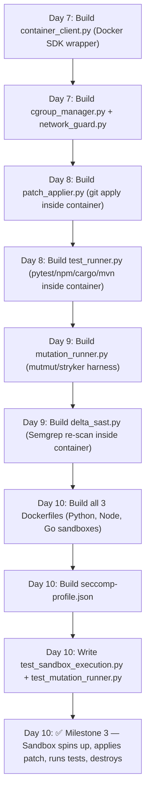
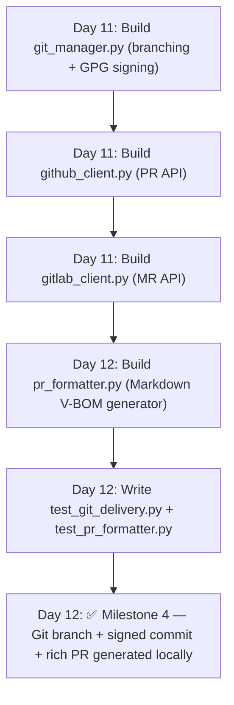
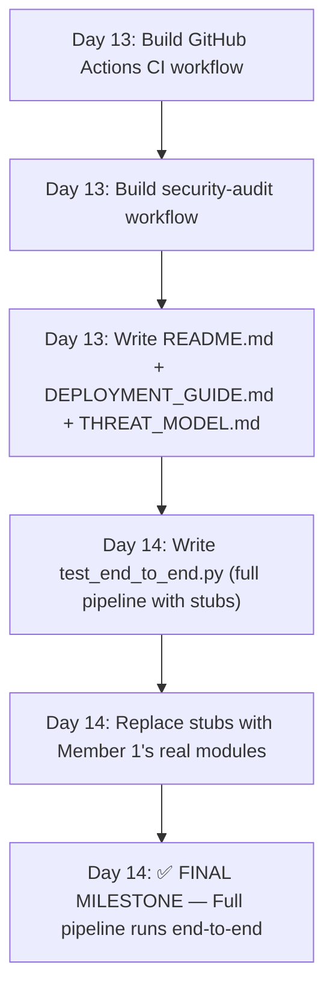

# PatchForge AI — Member 2 Task Assignment
## ⚙️ Role: Execution Infrastructure & Delivery Pipeline (The Body)
**Assigned To:** Member 2  
**Ownership:** LangGraph State Machine, Docker Sandbox, Mutation Testing, Delta-SAST, Git/PR Delivery, CLI, Configuration, Docker Images  
**Independence:** This workstream has **ZERO dependency** on Member 1 during development. Member 2 uses **mock/stub implementations** for all analysis functions (SARIF parser, slicer, Z3, agents) and tests the full infrastructure pipeline independently. At integration time, stubs are replaced with Member 1's real implementations via simple imports.

---

## 1. Responsibility Summary

```
┌──────────────────────────────────────────────────────────────────────┐
│                    MEMBER 2 — OWNERSHIP BOUNDARY                     │
│                                                                      │
│  ┌──────────────────────────────────────────────────────────────┐   │
│  │          LANGGRAPH STATE MACHINE (Orchestrator)               │   │
│  │  ┌───────────┐  ┌───────────┐  ┌───────────┐  ┌──────────┐  │   │
│  │  │ Ingest    │─►│ Slice     │─►│ Z3 Solve  │─►│ Agent    │  │   │
│  │  │ Node      │  │ Node      │  │ Node      │  │ Loop Node│  │   │
│  │  └───────────┘  └───────────┘  └───────────┘  └────┬─────┘  │   │
│  │                                                     │        │   │
│  │                    ┌────────────────────────────────┘        │   │
│  │                    ▼                                          │   │
│  │  ┌──────────────────────────────────────────────────────┐    │   │
│  │  │ Conditional Router: Pass/Fail/Escalate               │    │   │
│  │  └──────────────────────────────────────────────────────┘    │   │
│  └──────────────────────────────────────────────────────────────┘   │
│                                                                      │
│  ┌──────────────────────────────────────────────────────────────┐   │
│  │       HERMETIC DOCKER SANDBOX (Execution Environment)        │   │
│  │  ┌──────────────┐  ┌────────────┐  ┌───────────────────┐   │   │
│  │  │ Container    │  │ Test       │  │ Cgroup/Network    │   │   │
│  │  │ Manager      │  │ Runner     │  │ Guard             │   │   │
│  │  └──────────────┘  └────────────┘  └───────────────────┘   │   │
│  │  ┌──────────────┐  ┌────────────┐                          │   │
│  │  │ Mutation     │  │ Delta-SAST │                          │   │
│  │  │ Runner       │  │ Re-Scanner │                          │   │
│  │  └──────────────┘  └────────────┘                          │   │
│  └──────────────────────────────────────────────────────────────┘   │
│                                                                      │
│  ┌──────────────────────────────────────────────────────────────┐   │
│  │          VCS DELIVERY & PR DISPATCH                          │   │
│  │  ┌──────────────┐  ┌────────────┐  ┌───────────────────┐   │   │
│  │  │ Git Manager  │  │ GitHub     │  │ PR Formatter      │   │   │
│  │  │ (Branch/GPG) │  │ API Client │  │ (Markdown V-BOM)  │   │   │
│  │  └──────────────┘  └────────────┘  └───────────────────┘   │   │
│  └──────────────────────────────────────────────────────────────┘   │
│                                                                      │
│  ┌──────────────────────────────────────────────────────────────┐   │
│  │  CLI + CONFIG + DOCKERFILES + CI/CD                          │   │
│  └──────────────────────────────────────────────────────────────┘   │
└──────────────────────────────────────────────────────────────────────┘
```

---

## 2. Complete File List (All Files Member 2 Must Create)

Member 2 is responsible for generating **every file** listed below.

### 2.1 Project Bootstrap & Configuration

| # | File Path | Purpose |
|---|-----------|---------|
| 1 | `src/patchforge/__init__.py` | Root package init (version, top-level exports) |
| 2 | `src/patchforge/config.py` | Pydantic Settings: env vars, API keys, Docker config, defaults |
| 3 | `pyproject.toml` | Poetry / Hatch build configuration with all dependencies |
| 4 | `requirements.txt` | Locked production dependency versions |
| 5 | `.env.example` | Example environment variable file (API keys, Docker socket, GPG key) |

### 2.2 CLI Interface

| # | File Path | Purpose |
|---|-----------|---------|
| 6 | `src/patchforge/cli.py` | Typer/Click CLI: `patchforge run`, `patchforge status`, argument parsing |

### 2.3 Subsystem: LangGraph State Machine & Orchestrator

> [!IMPORTANT]
> This is the **central nervous system** of PatchForge. It wires together Member 1's analysis functions and Member 2's sandbox/delivery infrastructure into a single executable state graph.

| # | File Path | Purpose |
|---|-----------|---------|
| 7 | `src/patchforge/orchestrator/__init__.py` | Package init |
| 8 | `src/patchforge/orchestrator/graph.py` | LangGraph `StateGraph` definition — all nodes, edges, conditional routers |
| 9 | `src/patchforge/orchestrator/nodes.py` | Individual node functions (ingest, slice, solve, synthesize, verify, dispatch) |
| 10 | `src/patchforge/orchestrator/routers.py` | Conditional edge functions (pass/fail/escalate branching logic) |
| 11 | `src/patchforge/orchestrator/callbacks.py` | Execution lifecycle callbacks (logging, telemetry, token tracking) |

### 2.4 Subsystem: Hermetic Docker Sandbox

| # | File Path | Purpose |
|---|-----------|---------|
| 12 | `src/patchforge/sandbox/__init__.py` | Package init |
| 13 | `src/patchforge/sandbox/container_client.py` | Docker / Podman SDK wrapper: create, start, wait, collect logs, destroy |
| 14 | `src/patchforge/sandbox/cgroup_manager.py` | Memory (2GB), CPU (2 cores), PID (100) resource quota configuration |
| 15 | `src/patchforge/sandbox/network_guard.py` | Air-gap verification: validates `--network none` is active post-creation |
| 16 | `src/patchforge/sandbox/test_runner.py` | In-container test execution engine (pytest, npm test, cargo test, mvn test) |
| 17 | `src/patchforge/sandbox/mutation_runner.py` | Mutation testing harness: runs mutmut/stryker, collects mutation scores |
| 18 | `src/patchforge/sandbox/delta_sast.py` | In-sandbox static analysis re-scanner (Semgrep CLI) for post-patch verification |
| 19 | `src/patchforge/sandbox/patch_applier.py` | Applies `git diff` patches inside sandbox workspace, validates apply success |

### 2.5 Subsystem: VCS Integration & PR Delivery

| # | File Path | Purpose |
|---|-----------|---------|
| 20 | `src/patchforge/delivery/__init__.py` | Package init |
| 21 | `src/patchforge/delivery/git_manager.py` | Git operations: branch creation, worktree isolation, GPG commit signing |
| 22 | `src/patchforge/delivery/github_client.py` | GitHub REST/GraphQL API: create PR, add labels, attach review comments |
| 23 | `src/patchforge/delivery/gitlab_client.py` | GitLab REST API: create MR, add labels, attach notes |
| 24 | `src/patchforge/delivery/pr_formatter.py` | Rich Markdown PR body generator with Verification Bill of Materials (V-BOM) |

### 2.6 Docker Images & Container Security

| # | File Path | Purpose |
|---|-----------|---------|
| 25 | `Dockerfile` | Main PatchForge orchestrator Docker image (for Kubernetes deployment) |
| 26 | `docker/runtimes/python-3.11.Dockerfile` | Ephemeral sandbox image for Python projects |
| 27 | `docker/runtimes/node-20.Dockerfile` | Ephemeral sandbox image for Node.js/TypeScript projects |
| 28 | `docker/runtimes/go-1.22.Dockerfile` | Ephemeral sandbox image for Go projects |
| 29 | `docker/seccomp-profile.json` | Restricted syscall allowlist profile for container security |

### 2.7 CI/CD Workflows

| # | File Path | Purpose |
|---|-----------|---------|
| 30 | `.github/workflows/ci.yml` | GitHub Actions CI: lint, type-check, unit tests, integration tests |
| 31 | `.github/workflows/security-audit.yml` | Self-SAST: runs Semgrep/Bandit on PatchForge's own codebase |
| 32 | `.github/pull_request_template.md` | PR template for PatchForge contributions |

### 2.8 Documentation

| # | File Path | Purpose |
|---|-----------|---------|
| 33 | `README.md` | Project README: overview, quickstart, installation, usage, examples |
| 34 | `docs/THREAT_MODEL.md` | Full STRIDE threat model document |
| 35 | `docs/DEPLOYMENT_GUIDE.md` | Enterprise deployment guide (CLI, GitHub Action, Kubernetes) |

### 2.9 Integration Stubs (Used During Independent Development)

> [!NOTE]
> These stubs let Member 2 develop and test the ENTIRE orchestration pipeline without waiting for Member 1. Each stub returns hardcoded but realistic data matching the shared Pydantic models. At integration time, imports are simply switched from `stubs/` to Member 1's real packages.

| # | File Path | Purpose |
|---|-----------|---------|
| 36 | `src/patchforge/stubs/__init__.py` | Stub package init |
| 37 | `src/patchforge/stubs/mock_sarif_parser.py` | Returns hardcoded `VulnerabilityReport` from fixture data |
| 38 | `src/patchforge/stubs/mock_slicer.py` | Returns hardcoded `ASTContextSlice` (30-line Python snippet) |
| 39 | `src/patchforge/stubs/mock_z3_engine.py` | Returns hardcoded `FormalInvariant` with sample invariants |
| 40 | `src/patchforge/stubs/mock_agents.py` | Returns hardcoded `TestArtifact`, `PatchCandidate`, `AuditVerdict` |

### 2.10 Integration & End-to-End Tests

| # | File Path | Purpose |
|---|-----------|---------|
| 41 | `tests/integration/__init__.py` | Package init |
| 42 | `tests/integration/test_langgraph_pipeline.py` | Full state graph execution test (using stubs, no real LLM) |
| 43 | `tests/integration/test_sandbox_execution.py` | Docker sandbox spin-up, patch apply, test run, teardown |
| 44 | `tests/integration/test_mutation_runner.py` | Mutation engine test with sample project |
| 45 | `tests/integration/test_git_delivery.py` | Git branch creation, commit, GPG signing (local Git repo) |
| 46 | `tests/integration/test_pr_formatter.py` | PR Markdown generation with V-BOM content validation |
| 47 | `tests/integration/test_end_to_end.py` | Full pipeline: SARIF → (stubbed analysis) → Sandbox → PR (local) |

**Total files owned by Member 2: 47**

---

## 3. Step-by-Step Working Flow

### Phase 1: Project Bootstrap & Configuration (Day 1–2)



#### Phase 1 — Detailed Steps

**Step 1.1: Create `pyproject.toml`**
```
File: pyproject.toml

Sections:
  [project]
    name = "patchforge-ai"
    version = "0.1.0"
    python_requires = ">=3.11"

  [project.dependencies]
    # Member 1 deps (included so both work from same project)
    tree-sitter, tree-sitter-languages, networkx, z3-solver
    # Member 2 deps
    langgraph, langchain-core, docker, gitpython, PyGithub
    typer, pydantic, pydantic-settings, rich
    # Shared
    anthropic, openai, pytest

  [project.scripts]
    patchforge = "patchforge.cli:app"
```

**Step 1.2: Build Configuration Manager**
```
File: src/patchforge/config.py

Key class:
  class PatchForgeSettings(BaseSettings):
      # LLM
      llm_provider: str = "anthropic"     # "anthropic" | "deepseek"
      llm_api_key: SecretStr
      llm_model: str = "claude-sonnet-4-20250514"
      llm_temperature: float = 0.1

      # Sandbox
      docker_socket: str = "unix:///var/run/docker.sock"
      sandbox_memory_limit: str = "2048m"
      sandbox_cpu_limit: float = 2.0
      sandbox_pid_limit: int = 100
      sandbox_timeout_sec: int = 60
      sandbox_base_image: str = "patchforge-runner-py311:latest"

      # Git / VCS
      git_provider: str = "github"        # "github" | "gitlab"
      github_token: SecretStr
      gpg_key_id: Optional[str] = None
      auto_pr: bool = False

      # Orchestrator
      max_iterations: int = 5
      mutation_score_threshold: float = 85.0

      class Config:
          env_prefix = "PATCHFORGE_"
          env_file = ".env"
```

**Step 1.3: Build CLI**
```
File: src/patchforge/cli.py

Framework: Typer (with Rich console output)

Commands:
  patchforge run \
    --sarif <path>          # Required: SARIF report file
    --repo-path <path>      # Required: target repository
    --language <lang>       # Required: python | javascript | go | java | rust
    --max-iterations <n>    # Optional: default 5
    --gpg-sign-key <id>     # Optional: GPG key for commit signing
    --auto-pr               # Optional: auto-create GitHub/GitLab PR
    --dry-run               # Optional: show plan without executing

  patchforge status         # Show recent remediation runs
  patchforge version        # Print version info
```

**Step 1.4: Create All Mock/Stub Modules**
```
Files:
  src/patchforge/stubs/mock_sarif_parser.py
  src/patchforge/stubs/mock_slicer.py
  src/patchforge/stubs/mock_z3_engine.py
  src/patchforge/stubs/mock_agents.py

Each stub:
  - Imports shared Pydantic models from src/patchforge/models/
  - Returns hardcoded realistic data matching the model schema
  - Example: mock_slicer.py returns a 35-line Python slice with a SQL injection sink

Purpose:
  - Lets Member 2 develop and test the ENTIRE pipeline without waiting for Member 1
  - At integration, replace: `from patchforge.stubs.mock_slicer import ...`
                       with: `from patchforge.slicing.backward_slice import ...`
```

---

### Phase 2: LangGraph Orchestrator (Day 3–6)



#### Phase 2 — Detailed Steps

**Step 2.1: Define the State Graph**
```
File: src/patchforge/orchestrator/graph.py

Key function:
  def build_remediation_graph() -> StateGraph:
      graph = StateGraph(RemediationGraphState)

      # Add nodes (each calls a function from nodes.py)
      graph.add_node("ingest_sarif", ingest_sarif_node)
      graph.add_node("slice_ast", slice_ast_node)
      graph.add_node("solve_invariants", solve_invariants_node)
      graph.add_node("synthesize_test", synthesize_test_node)
      graph.add_node("synthesize_patch", synthesize_patch_node)
      graph.add_node("audit_patch", audit_patch_node)
      graph.add_node("execute_sandbox", execute_sandbox_node)
      graph.add_node("run_mutation_testing", run_mutation_node)
      graph.add_node("run_delta_sast", run_delta_sast_node)
      graph.add_node("reflect_and_critique", reflect_node)
      graph.add_node("dispatch_pr", dispatch_pr_node)
      graph.add_node("escalate_to_human", escalate_node)

      # Add linear edges
      graph.add_edge("ingest_sarif", "slice_ast")
      graph.add_edge("slice_ast", "solve_invariants")
      graph.add_edge("solve_invariants", "synthesize_test")
      graph.add_edge("synthesize_test", "synthesize_patch")
      graph.add_edge("synthesize_patch", "audit_patch")
      graph.add_edge("audit_patch", "execute_sandbox")

      # Add conditional edges
      graph.add_conditional_edges("execute_sandbox", sandbox_router)
      graph.add_conditional_edges("run_delta_sast", delta_sast_router)
      graph.add_conditional_edges("reflect_and_critique", loop_bound_router)

      graph.add_edge("run_mutation_testing", "run_delta_sast")
      graph.add_edge("dispatch_pr", END)
      graph.add_edge("escalate_to_human", END)

      graph.set_entry_point("ingest_sarif")
      return graph.compile()
```

**Step 2.2: Implement Node Functions**
```
File: src/patchforge/orchestrator/nodes.py

Each node function signature:
  def <node_name>(state: RemediationGraphState) -> dict:
      # Calls Member 1's module (or stub during dev)
      # Returns partial state update dict

Example node:
  def ingest_sarif_node(state: RemediationGraphState) -> dict:
      vulns = parse_sarif_file(state["sarif_raw"]["file_path"])
      return {
          "vulnerability": vulns[0].location,
          "cwe_id": vulns[0].cwe_id,
          "status": "SLICING"
      }

  def execute_sandbox_node(state: RemediationGraphState) -> dict:
      sandbox = HermeticSandboxHarness()
      result = sandbox.execute_verification_pipeline(
          repo_path=state["repo_path"],
          patch_diff=state["candidate_patch_diff"],
          reproduction_test=state["reproduction_test"],
          language=state["language"]
      )
      return {"sandbox_result": result}
```

**Step 2.3: Implement Conditional Routers**
```
File: src/patchforge/orchestrator/routers.py

Key functions:
  def sandbox_router(state: RemediationGraphState) -> str:
      result = state["sandbox_result"]
      if result.baseline_passed and result.reproduction_defended:
          return "run_mutation_testing"
      else:
          return "reflect_and_critique"

  def delta_sast_router(state: RemediationGraphState) -> str:
      result = state["sandbox_result"]
      if result.delta_sast_clean and result.mutation_score >= 85.0:
          return "dispatch_pr"
      else:
          return "reflect_and_critique"

  def loop_bound_router(state: RemediationGraphState) -> str:
      if state["iteration_count"] >= state["max_iterations"]:
          return "escalate_to_human"
      else:
          return "synthesize_patch"
```

**Step 2.4: Execution Callbacks**
```
File: src/patchforge/orchestrator/callbacks.py

Key class:
  class PatchForgeCallbackHandler:
      def on_node_start(self, node_name: str, state: dict) -> None:
          # Log: "[STEP] Starting node: ingest_sarif"
      def on_node_end(self, node_name: str, state: dict) -> None:
          # Log: "[DONE] Node ingest_sarif completed in 1.2s"
      def on_iteration(self, k: int, max_k: int) -> None:
          # Log: "[LOOP] Iteration 2/5"
      def on_error(self, node_name: str, error: Exception) -> None:
          # Log: "[ERROR] Node execute_sandbox failed: <traceback>"
```

---

### Phase 3: Hermetic Docker Sandbox (Day 7–10)



#### Phase 3 — Detailed Steps

**Step 3.1: Container Client (Core Sandbox Manager)**
```
File: src/patchforge/sandbox/container_client.py

Input:  repo_mount_dir (str), patch_diff (str), command (str)
Output: SandboxResult

Key class:
  class HermeticSandboxHarness:
      def __init__(self, settings: PatchForgeSettings)
      def create_container(self, repo_dir: str) -> Container
      def execute_in_sandbox(self, repo_dir: str, command: str, timeout: int = 60) -> SandboxResult
      def execute_verification_pipeline(self, repo_path, patch_diff, reproduction_test, language) -> SandboxResult
      def cleanup(self, container: Container) -> None

Container creation parameters:
  - image: settings.sandbox_base_image
  - network_mode: "none"              # AIR-GAPPED
  - mem_limit: "2048m"                # 2GB RAM cap
  - nano_cpus: 2_000_000_000          # 2.0 CPU cap
  - pids_limit: 100                   # Fork-bomb protection
  - cap_drop: ["ALL"]                 # Zero Linux capabilities
  - security_opt: ["no-new-privileges:true"]
  - read_only: True                   # Read-only root filesystem
  - tmpfs: {"/tmp": "size=512m", "/run": "size=64m"}
  - user: "1001:1001"                 # Non-root execution
```

**Step 3.2: Resource Quota Manager**
```
File: src/patchforge/sandbox/cgroup_manager.py

Key class:
  class CgroupResourceManager:
      def configure_limits(self, memory_mb: int, cpu_cores: float, pid_limit: int) -> dict:
          # Returns Docker-compatible resource constraint dict
      def validate_enforcement(self, container: Container) -> bool:
          # Verifies cgroup limits are actually applied post-creation
```

**Step 3.3: Network Isolation Guard**
```
File: src/patchforge/sandbox/network_guard.py

Key class:
  class NetworkIsolationGuard:
      def verify_air_gap(self, container: Container) -> bool:
          # Inspects container network settings
          # Confirms network_mode == "none"
          # Optionally runs: `container.exec_run("curl -s http://example.com")` → must FAIL
      def report_violation(self, container: Container) -> str:
          # Returns human-readable violation report if network is detected
```

**Step 3.4: Patch Applier**
```
File: src/patchforge/sandbox/patch_applier.py

Key class:
  class PatchApplier:
      def apply_diff(self, container: Container, diff_content: str) -> bool:
          # Writes diff to /tmp/candidate.patch inside container
          # Runs: git apply /tmp/candidate.patch
          # Returns True if applied cleanly, False if conflicts
      def write_test_file(self, container: Container, test: TestArtifact) -> None:
          # Writes reproduction test file into the container workspace
```

**Step 3.5: In-Container Test Runner**
```
File: src/patchforge/sandbox/test_runner.py

Key class:
  class SandboxTestRunner:
      def run_baseline_tests(self, container: Container, language: str) -> TestRunResult:
          # python → "pytest --tb=short -q"
          # javascript → "npm test"
          # go → "go test ./..."
          # java → "mvn test -q"
          # rust → "cargo test"
      def run_reproduction_test(self, container: Container, test: TestArtifact) -> TestRunResult:
          # Runs the PoC test independently
          # Expected: FAIL on unpatched code, PASS (defended) on patched code
      def collect_results(self, container: Container) -> TestRunResult:
          # Parses stdout/stderr, exit codes, individual test pass/fail counts
```

**Step 3.6: Mutation Testing Runner**
```
File: src/patchforge/sandbox/mutation_runner.py

Key class:
  class MutationTestRunner:
      def run_mutations(self, container: Container, target_file: str, language: str) -> MutationReport:
          # Python → "mutmut run --paths-to-mutate=<target_file>"
          # JS/TS → "npx stryker run --mutate=<target_file>"
      def calculate_mutation_score(self, report: MutationReport) -> float:
          # MS = killed / (total - equivalent) * 100
      def meets_threshold(self, score: float, threshold: float = 85.0) -> bool:
```

**Step 3.7: Delta-SAST Re-Scanner**
```
File: src/patchforge/sandbox/delta_sast.py

Key class:
  class DeltaSASTScanner:
      def rescan(self, container: Container, original_rule_id: str) -> DeltaSASTReport:
          # Runs: "semgrep --config auto --sarif -o /tmp/rescan.sarif ."
          # Parses output SARIF
      def verify_cwe_eliminated(self, report: DeltaSASTReport, target_rule_id: str) -> bool:
          # Returns True ONLY if original rule_id has 0 findings
      def check_no_new_findings(self, report: DeltaSASTReport, baseline_count: int) -> bool:
          # Returns True if total findings <= baseline (no new vulnerabilities introduced)
```

**Step 3.8: Sandbox Dockerfiles**
```
File: docker/runtimes/python-3.11.Dockerfile

  FROM python:3.11-slim-bookworm
  RUN apt-get update && apt-get install -y git && rm -rf /var/lib/apt/lists/*
  RUN pip install --no-cache-dir pytest mutmut semgrep bandit
  RUN useradd -m -u 1001 sandbox
  USER sandbox
  WORKDIR /workspace

File: docker/runtimes/node-20.Dockerfile

  FROM node:20-slim
  RUN apt-get update && apt-get install -y git && rm -rf /var/lib/apt/lists/*
  RUN npm install -g @stryker-mutator/core semgrep
  RUN useradd -m -u 1001 sandbox
  USER sandbox
  WORKDIR /workspace

File: docker/runtimes/go-1.22.Dockerfile

  FROM golang:1.22-bookworm
  RUN apt-get update && apt-get install -y git && rm -rf /var/lib/apt/lists/*
  RUN go install github.com/avito-tech/go-mutesting/cmd/go-mutesting@latest
  RUN useradd -m -u 1001 sandbox
  USER sandbox
  WORKDIR /workspace
```

**Step 3.9: Seccomp Profile**
```
File: docker/seccomp-profile.json

  Restricted syscall allowlist:
  - ALLOW: read, write, open, close, stat, fstat, mmap, mprotect, munmap,
           brk, clone, execve, exit_group, wait4, getpid, getuid, getgid
  - DENY: mount, umount, ptrace, reboot, swapon, swapoff, init_module,
          delete_module, socket (selectively), accept, listen, bind, connect
```

---

### Phase 4: VCS Delivery & PR Dispatch (Day 11–12)



#### Phase 4 — Detailed Steps

**Step 4.1: Git Manager**
```
File: src/patchforge/delivery/git_manager.py

Key class:
  class GitManager:
      def __init__(self, repo_path: str, gpg_key_id: Optional[str] = None)
      def create_remediation_branch(self, cwe_id: str) -> str:
          # Creates: patchforge/remediate-cwe-89-<short_hash>
      def apply_and_stage(self, diff: str, test_file: TestArtifact) -> None:
          # Applies patch diff, stages modified files + new test file
      def create_signed_commit(self, message: str) -> str:
          # Creates GPG-signed commit, returns commit SHA
      def push_branch(self, branch_name: str, remote: str = "origin") -> None:
```

**Step 4.2: GitHub Client**
```
File: src/patchforge/delivery/github_client.py

Key class:
  class GitHubPRClient:
      def __init__(self, token: str, repo_full_name: str)
      def create_pull_request(self, branch: str, title: str, body: str, labels: List[str]) -> str:
          # Returns PR URL
      def add_review_comment(self, pr_number: int, comment: str) -> None
      def attach_verification_badge(self, pr_number: int, status: str) -> None
```

**Step 4.3: GitLab Client**
```
File: src/patchforge/delivery/gitlab_client.py

Key class:
  class GitLabMRClient:
      def __init__(self, token: str, project_id: str)
      def create_merge_request(self, branch: str, title: str, description: str, labels: List[str]) -> str:
      def add_note(self, mr_iid: int, note: str) -> None
```

**Step 4.4: PR Body Formatter (Verification Bill of Materials)**
```
File: src/patchforge/delivery/pr_formatter.py

Key class:
  class PRFormatter:
      def format_pr_body(self, state: RemediationGraphState) -> str:
          # Generates rich Markdown PR body containing:
          # 1. 🛡️ Vulnerability Summary (CWE, severity, file, line)
          # 2. 🔬 AST Slice Analysis (what code was analyzed)
          # 3. 🧮 Z3 Formal Invariants (mathematical proofs)
          # 4. 🧪 Sandbox Verification Matrix:
          #    - Baseline Tests: ✅ 142/142 passed
          #    - Reproduction PoC: ✅ Attack neutralized
          #    - Mutation Score: ✅ 92.3% (threshold: 85%)
          #    - Delta-SAST: ✅ 0 findings (original CWE eliminated)
          # 5. 📝 Diff Explanation
          # 6. 📊 Execution Telemetry (timing, iterations, tokens used)

      def format_pr_title(self, cwe_id: str, file_path: str) -> str:
          # "[PatchForge] Remediation for CWE-89: SQL Injection in backend/views/user.py"
```

---

### Phase 5: CI/CD, Documentation & Integration (Day 13–14)



#### Phase 5 — Detailed Steps

**Step 5.1: GitHub Actions CI**
```
File: .github/workflows/ci.yml

Jobs:
  lint:
    - ruff check src/
    - mypy src/patchforge/ --strict
  test:
    - pytest tests/unit/ -v
    - pytest tests/integration/ -v --timeout=120
  build:
    - docker build -t patchforge-ai .
    - docker build -f docker/runtimes/python-3.11.Dockerfile -t patchforge-runner-py311 .
```

**Step 5.2: Security Self-Audit**
```
File: .github/workflows/security-audit.yml

  - Run Semgrep on src/patchforge/
  - Run Bandit on src/patchforge/
  - Fail CI if any HIGH/CRITICAL findings detected
```

**Step 5.3: README.md**
```
File: README.md

Sections:
  - Project Overview & Architecture Diagram
  - Quick Start (3 commands to run)
  - Installation Guide
  - CLI Usage Examples
  - Configuration Reference (.env variables)
  - Deployment Options (CLI, GitHub Action, Kubernetes)
  - Contributing Guide
  - License
```

---

## 4. Technology Stack (Member 2 Only)

| Library | Version | Purpose |
|---------|---------|---------|
| `langgraph` | ≥0.2 | State machine orchestration framework |
| `langchain-core` | ≥0.3 | Base abstractions for agent state |
| `docker` | ≥7.0 | Docker SDK for Python (container management) |
| `gitpython` | ≥3.1 | Programmatic Git operations (branch, commit, push) |
| `PyGithub` | ≥2.1 | GitHub REST API client |
| `python-gitlab` | ≥4.0 | GitLab REST API client |
| `typer` | ≥0.12 | CLI framework with rich help |
| `rich` | ≥13.0 | Terminal formatting and progress bars |
| `pydantic` | ≥2.5 | Data validation (shared with Member 1) |
| `pydantic-settings` | ≥2.2 | Environment-based configuration |
| `pytest` | ≥8.0 | Testing framework |
| `pytest-docker` | ≥3.0 | Docker integration testing fixtures |

**Install command:**
```bash
pip install langgraph langchain-core docker gitpython PyGithub python-gitlab typer rich pydantic pydantic-settings pytest pytest-docker
```

---

## 5. How to Test Everything Independently (No Member 1 Code Needed)

Member 2 can verify the **entire pipeline** using stubs:

```bash
# Test the LangGraph state machine (stubs for analysis, real sandbox)
pytest tests/integration/test_langgraph_pipeline.py -v

# Test Docker sandbox (requires Docker daemon running)
pytest tests/integration/test_sandbox_execution.py -v

# Test mutation engine
pytest tests/integration/test_mutation_runner.py -v

# Test Git operations (creates local test repo, no push)
pytest tests/integration/test_git_delivery.py -v

# Test PR body formatting
pytest tests/integration/test_pr_formatter.py -v

# Full end-to-end with stubs
pytest tests/integration/test_end_to_end.py -v

# Run all
pytest tests/integration/ -v --timeout=120
```

### Quick Smoke Test (End-to-End with Stubs):
```python
from patchforge.orchestrator.graph import build_remediation_graph
from patchforge.models.state import RemediationGraphState

# Build the LangGraph state machine
graph = build_remediation_graph(use_stubs=True)  # Uses mock modules

# Create initial state
initial_state: RemediationGraphState = {
    "sarif_raw": {"file_path": "tests/fixtures/sarif/semgrep_cwe89_sqli.sarif.json"},
    "repo_path": "tests/fixtures/repositories/vulnerable_flask_app/",
    "language": "python",
    "iteration_count": 0,
    "max_iterations": 5,
    "error_feedback_history": [],
    "status": "INITIALIZING"
}

# Execute the full pipeline
final_state = graph.invoke(initial_state)
print(f"Status: {final_state['status']}")           # "SUCCEEDED" or "ESCALATED"
print(f"PR URL: {final_state.get('pr_url', 'N/A')}")
print(f"Iterations: {final_state['iteration_count']}")
```

---

## 6. Interface Contract with Member 1

Member 2 **consumes** the following function signatures that Member 1 implements. During development, Member 2 uses stubs returning hardcoded data:

```python
# ═══════════════════════════════════════════════════════════════
# WHAT MEMBER 2 IMPORTS FROM MEMBER 1 (stubs during dev, real at integration)
# ═══════════════════════════════════════════════════════════════

# In orchestrator/nodes.py:
if USE_STUBS:
    from patchforge.stubs.mock_sarif_parser import parse_sarif_file
    from patchforge.stubs.mock_slicer import BackwardTaintSlicer
    from patchforge.stubs.mock_z3_engine import SMTInvariantVerifier
    from patchforge.stubs.mock_agents import TestSynthesizerAgent, PatchSynthesizerAgent, AntiTamperAuditor, ReflectionEngine
else:
    # ↓↓↓ REAL IMPORTS (switch to these at integration) ↓↓↓
    from patchforge.ingestion.sarif_parser import parse_sarif_file
    from patchforge.slicing.backward_slice import BackwardTaintSlicer
    from patchforge.formal.invariant_engine import SMTInvariantVerifier
    from patchforge.agents.test_synthesizer import TestSynthesizerAgent
    from patchforge.agents.patch_synthesizer import PatchSynthesizerAgent
    from patchforge.agents.auditor import AntiTamperAuditor
    from patchforge.agents.reflection import ReflectionEngine
```

> [!TIP]
> At integration time, Member 2 only changes a single flag (`USE_STUBS = False`) or updates import paths. The function signatures are identical because both members work from the same shared Pydantic models.

---

## 7. Key Deliverable Checklist

- [ ] `config.py` + `pyproject.toml` + `.env.example` — Project bootstrap
- [ ] `cli.py` — Full Typer CLI with `run`, `status`, `version` commands
- [ ] `orchestrator/` package — LangGraph state graph, nodes, routers, callbacks (4 files)
- [ ] `sandbox/` package — Container client, cgroup, network guard, test runner, mutation, delta-SAST, patch applier (8 files)
- [ ] `delivery/` package — Git manager, GitHub client, GitLab client, PR formatter (4 files)
- [ ] `stubs/` package — 4 mock modules for independent development
- [ ] `docker/runtimes/` — 3 Dockerfiles + 1 seccomp profile
- [ ] `.github/workflows/` — CI + security-audit YAML + PR template
- [ ] `README.md` + `docs/THREAT_MODEL.md` + `docs/DEPLOYMENT_GUIDE.md`
- [ ] Integration tests — 7 test files covering graph, sandbox, git, PR, end-to-end

