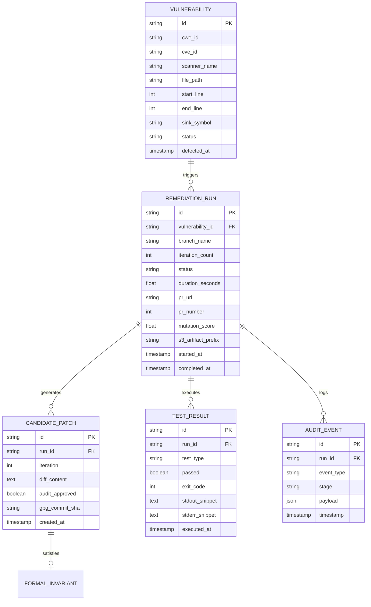
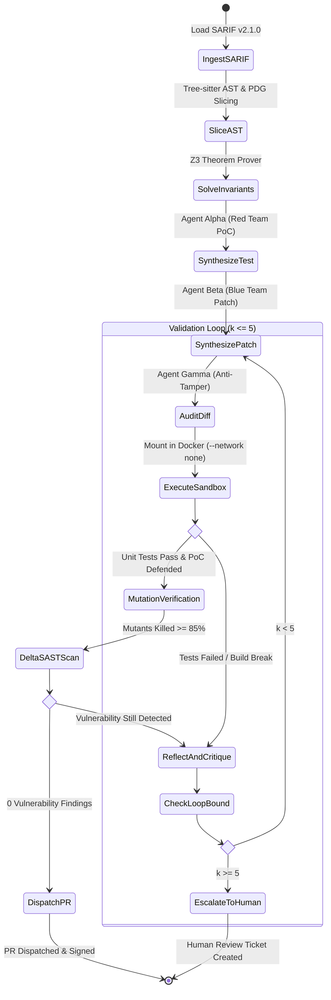
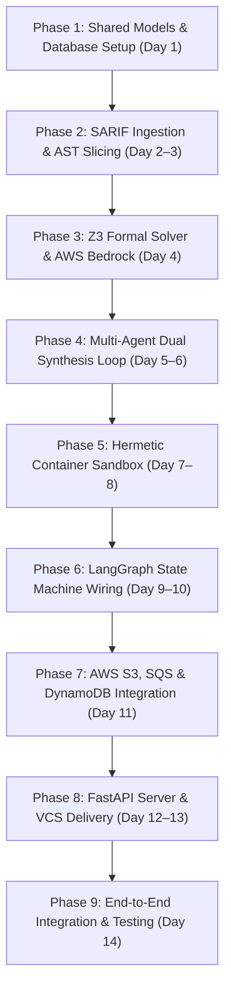

# PatchForge AI — Backend Architecture & Working Flow Specification
**Document Version:** 1.0.0  
**Project:** PatchForge AI (Autonomous Self-Healing DevSecOps Engine)  
**Target Environment:** Cloud-Native Microservices, Kubernetes (EKS), Rootless Container Sandboxes  
**Core Technologies:** Python 3.11+, LangGraph, Tree-sitter, Microsoft Z3, Docker SDK, FastAPI, AWS (Bedrock, S3, SQS, DynamoDB), PostgreSQL / SQLite, SQLAlchemy, Alembic  

---

## 1. Executive Backend Architecture & Design Principles

The **PatchForge AI** backend is engineered as an event-driven, formally verified autonomous program synthesis pipeline. It transforms passive static diagnostic reports (SARIF) into cryptographically signed, functionally regression-free Pull Requests.

```
┌─────────────────────────────────────────────────────────────────────────────────────────────────┐
│                                 MASTER BACKEND PIPELINE FLOW                                    │
│                                                                                                 │
│  [SARIF Report / SQS Queue]                                                                     │
│             │                                                                                   │
│             ▼                                                                                   │
│  ┌─────────────────────────────┐    ┌─────────────────────────────┐    ┌─────────────────────┐  │
│  │ 1. Ingestion & Normalizer   │───►│ 2. Tree-sitter AST & PDG    │───►│ 3. Z3 SMT Formal    │  │
│  │    (Semgrep, Snyk, Bandit)  │    │    Backward Taint Slicer    │    │    Invariant Solver │  │
│  └─────────────────────────────┘    └─────────────────────────────┘    └─────────────────────┘  │
│                                                                                   │             │
│                                                                                   ▼             │
│  ┌───────────────────────────────────────────────────────────────────────────────────────────┐  │
│  │ 4. LangGraph Multi-Agent Dual Loop                                                        │  │
│  │    - Agent Alpha: Synthesizes dynamic reproduction exploit PoC test                       │  │
│  │    - Agent Beta: Synthesizes minimal AST patch delta under Z3 formal invariants           │  │
│  │    - Agent Gamma: Anti-Tamper Auditor validates diff invariants (no test deletions)       │  │
│  └─────────────────────────────────────────────┬─────────────────────────────────────────────┘  │
│                                                │                                                │
│                                                ▼                                                │
│  ┌───────────────────────────────────────────────────────────────────────────────────────────┐  │
│  │ 5. Hermetic Docker Sandbox Execution Harness                                              │  │
│  │    - Network Isolation: `--network none` (Air-gapped)                                     │  │
│  │    - Linux cgroups: 2048MB RAM, 2.0 CPUs, 100 PIDs, 60s Watchdog                          │  │
│  │    - Dual Evaluation Gate: Baseline Tests (PASS) + Exploit Test (BLOCKED)                 │  │
│  │    - AST Mutation Testing: `mutmut` mutation kill-rate threshold >= 85%                   │  │
│  │    - Delta-SAST Re-Scan: Target CWE completely eliminated (0 findings)                    │  │
│  └──────────────────────┬────────────────────────────────────────────────────────────────────┘  │
│                         │                                                                       │
│          ┌──────────────┴──────────────┐                                                        │
│   [Fail / Regress]              [All Gates Pass]                                                │
│          │                             │                                                        │
│          ▼                             ▼                                                        │
│  ┌───────────────────────┐     ┌─────────────────────────────────────────────────────────────┐  │
│  │ Bounded Reflection    │     │ 6. VCS Delivery, GPG Signing & Cloud Persistence            │  │
│  │ Loop (k <= 5 retries) │     │    - GPG-signed git commit on dedicated branch              │  │
│  └──────────┬────────────┘     │    - Automated GitHub/GitLab Pull Request dispatched        │  │
│             │                  │    - Audit trail committed to PostgreSQL & Amazon DynamoDB  │  │
│             └──► (Retry Beta)  │    - Raw SARIF, patch diffs, V-BOM archived to Amazon S3   │  │
│                                └─────────────────────────────────────────────────────────────┘  │
└─────────────────────────────────────────────────────────────────────────────────────────────────┘
```

### 1.1 Core Engineering Principles
1. **Determinism over Stochasticity:** LLMs formulate candidate diffs, but deterministic tools (Tree-sitter, Z3 Theorem Prover, Docker sandbox, pytest, mutmut) hold absolute veto power.
2. **Context Minimization:** Large codebases dilute LLM attention. Tree-sitter backward taint slicing reduces 1,000+ line files to a 30–50 line isolated Program Dependence Graph (PDG) slice.
3. **Formal Invariant Enforcement:** Arithmetic, string, and buffer boundaries are formally translated into First-Order Predicate Logic and verified with Microsoft Z3 to mathematically prevent buffer overflows and off-by-one regressions.
4. **Zero-Trust Hermetic Isolation:** Candidate code is considered hostile. Build compilation and regression tests run inside rootless micro-containers with zero external network connectivity (`--network none`).
5. **Polyglot Database Strategy:** Relational data (vulnerabilities, runs, branches, test telemetry) persists in PostgreSQL (or local SQLite for dev); immutable audit trails persist in Amazon DynamoDB; and raw artifacts (SARIF, diffs, V-BOM) persist in Amazon S3.

---

## 2. Complete Backend File Structure

All backend code resides in `src/patchforge/` with tests in `tests/` and container environments in `docker/`.

```
PatchForge AI/
├── src/
│   └── patchforge/
│       ├── __init__.py                  # Root package initialization & version metadata
│       ├── cli.py                       # CLI command dispatcher (Typer / Rich)
│       ├── config.py                    # Global Pydantic Settings (Environment & AWS config)
│       │
│       ├── models/                      # Shared Interface Contracts & Pydantic Schemas
│       │   ├── __init__.py              # Re-exports all shared data structures
│       │   ├── vulnerability.py         # VulnerabilityLocation, SARIFFinding, FindingSeverity
│       │   ├── slicing.py               # ASTContextSlice, PDGNode, SlicingResult
│       │   ├── formal.py                # FormalInvariant, Z3VerificationResult, BoundaryConstraint
│       │   ├── agents.py                # TestArtifact, PatchCandidate, AuditVerdict, ReflectionFeedback
│       │   ├── sandbox.py               # SandboxResult, MutationReport, DeltaSASTReport
│       │   └── state.py                 # RemediationGraphState TypedDict (LangGraph memory)
│       │
│       ├── db/                          # Database Persistence Layer (Relational + ORM)
│       │   ├── __init__.py              # Database package entry point
│       │   ├── session.py               # SQLAlchemy async & sync engine / sessionmaker
│       │   ├── base.py                  # Declarative base & common model mixins
│       │   ├── models.py                # Relational entities: Vulnerability, Run, Patch, AuditEvent
│       │   ├── crud.py                  # Data access layer for CRUD operations
│       │   └── migrations/              # Alembic migration environment
│       │       ├── env.py               # Alembic runner environment
│       │       ├── script.py.mako       # Migration template
│       │       └── versions/            # Versioned SQL migration scripts
│       │
│       ├── aws/                         # AWS Cloud-Native Integration Layer
│       │   ├── __init__.py              # AWS package entry point
│       │   ├── s3_client.py             # Amazon S3: SARIF storage, patch diffs, V-BOM archiving
│       │   ├── sqs_client.py            # Amazon SQS: Asynchronous vulnerability event queue
│       │   ├── dynamodb_client.py       # Amazon DynamoDB: NoSQL run history & audit ledger
│       │   ├── bedrock_client.py        # AWS Bedrock: Claude 3.5 Sonnet managed inference
│       │   └── ecr_client.py            # Amazon ECR: Sandbox container runtime image registry
│       │
│       ├── api/                         # FastAPI Web Server & Real-Time Telemetry
│       │   ├── __init__.py              # API package entry point
│       │   ├── server.py                # FastAPI app initialization, middleware, CORS
│       │   ├── schemas.py               # API request/response schemas
│       │   └── routes/                  # Modular endpoint routers
│       │       ├── __init__.py
│       │       ├── dashboard.py         # GET /api/dashboard (summary metrics, health)
│       │       ├── vulnerabilities.py   # GET /api/vulns, GET /api/vulns/{id}
│       │       ├── runs.py              # GET /api/runs, POST /api/runs/trigger
│       │       └── pipeline.py          # WebSocket /ws/pipeline (real-time telemetry)
│       │
│       ├── ingestion/                   # Subsystem 1: Diagnostic Parser & Normalizer
│       │   ├── __init__.py
│       │   ├── sarif_parser.py          # SARIF v2.1.0 schema validator and extractor
│       │   ├── normalizer.py            # Canonical target location & sink mapper
│       │   └── scanner_adapters/        # Scanner-specific rule & offset adapters
│       │       ├── __init__.py
│       │       ├── semgrep.py           # Semgrep SARIF parser & tainted sink extractor
│       │       ├── snyk.py              # Snyk SARIF adapter
│       │       └── bandit.py            # Bandit Python AST security analyzer adapter
│       │
│       ├── slicing/                     # Subsystem 2: AST & Program Dependence Graph
│       │   ├── __init__.py
│       │   ├── parser.py                # Tree-sitter multi-language parser wrapper
│       │   ├── cfg_builder.py           # Control Flow Graph (CFG) builder from AST
│       │   ├── ddg_builder.py           # Data Dependence Graph (DDG) Def-Use builder
│       │   ├── pdg.py                   # Program Dependence Graph (PDG) graph union
│       │   └── backward_slice.py        # Backward taint slice reachability extractor
│       │
│       ├── formal/                      # Subsystem 3: Microsoft Z3 SMT Prover
│       │   ├── __init__.py
│       │   ├── z3_translator.py         # AST conditional expressions to FOL compiler
│       │   ├── invariant_engine.py      # Z3 solver: satisfiability & counterexample model
│       │   └── boundary_checker.py      # Array indexing, buffer overflow & integer bounds
│       │
│       ├── agents/                      # Subsystem 4: Adversarial Multi-Agent Engine
│       │   ├── __init__.py
│       │   ├── prompts.py               # Versioned system & user prompt templates
│       │   ├── llm_client.py            # Unified LLM inference wrapper (Bedrock / Direct API)
│       │   ├── test_synthesizer.py      # Agent Alpha: Dynamic reproduction exploit generator
│       │   ├── patch_synthesizer.py     # Agent Beta: Minimal unified diff synthesizer
│       │   ├── auditor.py               # Agent Gamma: Anti-tamper diff invariant auditor
│       │   └── reflection.py            # Reflection engine: stderr/stacktrace critique builder
│       │
│       ├── orchestrator/                # Central Nervous System: LangGraph State Machine
│       │   ├── __init__.py
│       │   ├── graph.py                 # StateGraph compilation, node & edge definitions
│       │   ├── nodes.py                 # Executable state graph node functions
│       │   ├── routers.py               # Conditional edge branching routers
│       │   └── callbacks.py             # Lifecycle callbacks & WebSocket broad-caster
│       │
│       ├── sandbox/                     # Subsystem 5: Hermetic Container Sandbox
│       │   ├── __init__.py
│       │   ├── container_client.py      # Docker / Podman SDK lifecycle manager
│       │   ├── cgroup_manager.py        # Memory (2GB), CPU (2.0), PID (100) quotas
│       │   ├── network_guard.py         # Air-gap verification harness (--network none)
│       │   ├── patch_applier.py         # Workspace diff patcher & conflict validator
│       │   ├── test_runner.py           # In-container unit/integration test executor
│       │   ├── mutation_runner.py       # mutmut / Stryker mutation testing harness
│       │   └── delta_sast.py            # In-sandbox static analyzer re-scanner
│       │
│       └── delivery/                    # Subsystem 6: Version Control & PR Dispatch
│           ├── __init__.py
│           ├── git_manager.py           # Worktree isolation, branching & GPG commit signing
│           ├── github_client.py         # PyGithub REST client (PR, labels, review comments)
│           ├── gitlab_client.py         # GitLab REST API client
│           └── pr_formatter.py          # Markdown PR body with Verification BOM (V-BOM)
│
├── docker/
│   ├── runtimes/
│   │   ├── python-3.11.Dockerfile       # Ephemeral sandbox image for Python
│   │   ├── node-20.Dockerfile           # Ephemeral sandbox image for Node/TS
│   │   └── go-1.22.Dockerfile           # Ephemeral sandbox image for Go
│   └── seccomp-profile.json             # Restricted syscall whitelist for sandbox
│
├── tests/
│   ├── unit/                            # Pure Python unit tests (Tree-sitter, Z3, Parsers)
│   ├── integration/                     # Pipeline, Docker Sandbox, AWS Moto integration tests
│   └── fixtures/                        # Sample SARIF reports & vulnerable repos
│
├── pyproject.toml                       # Build system & dependency specifications
├── requirements.txt                     # Production frozen dependency locks
├── Dockerfile                           # PatchForge orchestrator server Dockerfile
└── README.md
```

---

## 3. Database Architecture & Data Persistence Layer

PatchForge AI uses a **hybrid polyglot persistence architecture**:
1. **Relational Database (PostgreSQL / SQLite):** Stores structured entity graphs, vulnerability locations, remediation run records, and test outcomes.
2. **NoSQL Audit Ledger (Amazon DynamoDB):** Stores high-throughput immutable audit event streams and powers fast dashboard queries for historical runs.
3. **Object Storage (Amazon S3):** Stores large binary/text artifacts (raw SARIF files, candidate patch diffs, full container stdout logs, and cryptographic V-BOM packages).



### 3.1 Relational Schema Definitions (PostgreSQL / SQLite)

#### Entity: `vulnerabilities`
Tracks static security scan findings ingested from SARIF reports.
```sql
CREATE TABLE vulnerabilities (
    id VARCHAR(64) PRIMARY KEY,
    cwe_id VARCHAR(32) NOT NULL,                -- e.g., 'CWE-89'
    cve_id VARCHAR(32),                         -- e.g., 'CVE-2026-3819'
    scanner_name VARCHAR(64) NOT NULL,          -- e.g., 'Semgrep', 'Bandit'
    rule_id VARCHAR(256) NOT NULL,              -- e.g., 'python.django.security.injection.sql'
    file_path VARCHAR(512) NOT NULL,            -- e.g., 'backend/views/user.py'
    start_line INTEGER NOT NULL,
    end_line INTEGER NOT NULL,
    start_col INTEGER DEFAULT 0,
    end_col INTEGER DEFAULT 0,
    sink_symbol TEXT NOT NULL,                  -- e.g., 'cursor.execute(query)'
    severity VARCHAR(16) NOT NULL,              -- 'CRITICAL', 'HIGH', 'MEDIUM', 'LOW'
    skull_count INTEGER NOT NULL DEFAULT 3,     -- 1 to 5 skulls for Halloween UI
    status VARCHAR(32) NOT NULL DEFAULT 'OPEN', -- 'OPEN', 'IN_PROGRESS', 'RESOLVED', 'MUTED'
    raw_sarif_hash VARCHAR(64) NOT NULL,
    detected_at TIMESTAMP WITH TIME ZONE DEFAULT CURRENT_TIMESTAMP,
    updated_at TIMESTAMP WITH TIME ZONE DEFAULT CURRENT_TIMESTAMP
);

CREATE INDEX idx_vuln_cwe ON vulnerabilities(cwe_id);
CREATE INDEX idx_vuln_status ON vulnerabilities(status);
CREATE INDEX idx_vuln_file ON vulnerabilities(file_path);
```

#### Entity: `remediation_runs`
Tracks each execution of the multi-agent closed-loop remediation pipeline.
```sql
CREATE TABLE remediation_runs (
    id VARCHAR(64) PRIMARY KEY,                 -- e.g., 'run-20261105-9a4f'
    vulnerability_id VARCHAR(64) NOT NULL REFERENCES vulnerabilities(id) ON DELETE CASCADE,
    repo_path VARCHAR(512) NOT NULL,
    target_branch VARCHAR(128) NOT NULL DEFAULT 'main',
    remediation_branch VARCHAR(128),            -- e.g., 'patchforge/remediate-cwe-89-9a4f'
    iteration_count INTEGER NOT NULL DEFAULT 0,
    max_iterations INTEGER NOT NULL DEFAULT 5,
    status VARCHAR(32) NOT NULL,                -- 'INITIALIZING', 'PATCHING', 'VERIFYING', 'SUCCEEDED', 'ESCALATED'
    baseline_tests_passed BOOLEAN DEFAULT FALSE,
    reproduction_defended BOOLEAN DEFAULT FALSE,
    mutation_score DOUBLE PRECISION DEFAULT 0.0,
    delta_sast_clean BOOLEAN DEFAULT FALSE,
    duration_seconds DOUBLE PRECISION DEFAULT 0.0,
    pr_url VARCHAR(512),
    pr_number INTEGER,
    commit_sha VARCHAR(64),
    s3_artifact_prefix VARCHAR(512),            -- S3 path: s3://patchforge-artifacts/runs/{id}/
    error_summary TEXT,
    started_at TIMESTAMP WITH TIME ZONE DEFAULT CURRENT_TIMESTAMP,
    completed_at TIMESTAMP WITH TIME ZONE
);

CREATE INDEX idx_runs_vuln_id ON remediation_runs(vulnerability_id);
CREATE INDEX idx_runs_status ON remediation_runs(status);
CREATE INDEX idx_runs_started ON remediation_runs(started_at DESC);
```

#### Entity: `candidate_patches`
Stores unified diffs synthesized by Agent Beta across discrete iterations $k \in \{1 \dots 5\}$.
```sql
CREATE TABLE candidate_patches (
    id VARCHAR(64) PRIMARY KEY,
    run_id VARCHAR(64) NOT NULL REFERENCES remediation_runs(id) ON DELETE CASCADE,
    iteration INTEGER NOT NULL,
    diff_content TEXT NOT NULL,                 -- Unified git diff
    ast_slice_range VARCHAR(64),                -- e.g., 'L39-L48'
    audit_approved BOOLEAN NOT NULL DEFAULT FALSE,
    audit_violations JSONB DEFAULT '[]'::jsonb,
    z3_proof_status VARCHAR(64),                -- 'UNCONDITIONALLY_SAFE', 'VIOLATION_POSSIBLE'
    created_at TIMESTAMP WITH TIME ZONE DEFAULT CURRENT_TIMESTAMP
);

CREATE INDEX idx_patches_run_iter ON candidate_patches(run_id, iteration);
```

#### Entity: `test_results`
Stores test harness outcomes executed inside the hermetic container sandbox.
```sql
CREATE TABLE test_results (
    id VARCHAR(64) PRIMARY KEY,
    run_id VARCHAR(64) NOT NULL REFERENCES remediation_runs(id) ON DELETE CASCADE,
    iteration INTEGER NOT NULL,
    test_type VARCHAR(32) NOT NULL,             -- 'BASELINE_UNIT', 'REPRODUCTION_POC', 'MUTATION', 'DELTA_SAST'
    passed BOOLEAN NOT NULL,
    exit_code INTEGER NOT NULL,
    tests_passed_count INTEGER DEFAULT 0,
    tests_failed_count INTEGER DEFAULT 0,
    stdout_snippet TEXT,
    stderr_snippet TEXT,
    duration_seconds DOUBLE PRECISION DEFAULT 0.0,
    executed_at TIMESTAMP WITH TIME ZONE DEFAULT CURRENT_TIMESTAMP
);

CREATE INDEX idx_test_run_type ON test_results(run_id, test_type);
```

### 3.2 Amazon DynamoDB Audit Trail Schema
For high-speed dashboard analytics and immutable compliance logging, all execution events are mirrored to DynamoDB table **`PatchForgeAuditTrail`**.

- **Table Name:** `PatchForgeAuditTrail`
- **Partition Key (PK):** `run_id` (String) — Unique pipeline run ID
- **Sort Key (SK):** `timestamp` (String) — ISO-8601 UTC timestamp (e.g., `2026-11-05T10:15:30.123Z`)
- **Attributes:**
  - `event_type`: `NODE_TRANSITION` | `AGENT_THOUGHT` | `SANDBOX_TELEMETRY` | `PR_DISPATCH`
  - `stage`: `ingest` | `slice` | `solve` | `synthesize` | `sandbox` | `dispatch`
  - `cwe_id`: e.g., `CWE-89`
  - `payload`: Structured JSON object containing diff snippet, Z3 constraints, or container stdout
  - `ttl`: UNIX epoch timestamp for automated 90-day data retention cleanup

#### Global Secondary Indexes (GSIs):
1. **`GSI_CWE`**: Partition Key: `cwe_id`, Sort Key: `timestamp` — Powers Graveyard queries by CWE type.
2. **`GSI_Status`**: Partition Key: `status`, Sort Key: `timestamp` — Powers real-time dashboard status filters.

---

## 4. Subsystem Deep Dive & Component Specifications

### 4.1 Subsystem 1: SARIF Ingestion & Diagnostic Parser
- **File:** `src/patchforge/ingestion/sarif_parser.py`
- **Responsibility:** Ingests SARIF v2.1.0 JSON reports generated by Semgrep, Bandit, Snyk, or CodeQL.
- **Workflow:**
  1. Validates SARIF JSON schema against the OASIS standard.
  2. Iterates over `runs[].results[]`.
  3. Maps rule metadata (`rules[].id`, `help.markdown`, `properties.cwe`).
  4. Resolves `physicalLocation.artifactLocation.uri` to workspace path.
  5. Computes `skull_count` (1 to 5 skulls) based on CVSS severity and CWE criticality.
  6. Emits normalized `VulnerabilityReport` models.

### 4.2 Subsystem 2: Tree-sitter AST & PDG Backward Taint Slicer
- **Files:** `src/patchforge/slicing/parser.py`, `cfg_builder.py`, `ddg_builder.py`, `backward_slice.py`
- **Responsibility:** Isolates the exact vulnerable execution slice, eliminating prompt bloat and context dilution.
- **Algorithm:**
  1. Tree-sitter parses the source into a Concrete Syntax Tree (CST).
  2. Generates a **Control Flow Graph (CFG)** using NetworkX (nodes = statements, edges = branch conditions/jumps).
  3. Generates a **Data Dependence Graph (DDG)** by computing reaching definitions (Def-Use chains).
  4. Merges CFG and DDG into a unified **Program Dependence Graph (PDG)**:
     $$G = (V, E_{\text{control}} \cup E_{\text{data}})$$
  5. Computes a **Backward Taint Slice** starting at the identified sink statement $s_{\text{sink}}$:
     $$\text{Slice}(s_{\text{sink}}) = \{ v \in V \mid v \xrightarrow{*} s_{\text{sink}} \}$$
  6. Preserves enclosing class/function signatures and necessary module import declarations.
  7. Returns `ASTContextSlice` (reducing prompt payload size by 80–90%).

### 4.3 Subsystem 3: Microsoft Z3 SMT Formal Invariant Solver
- **Files:** `src/patchforge/formal/z3_translator.py`, `invariant_engine.py`, `boundary_checker.py`
- **Responsibility:** Uses First-Order Logic to prove safety boundary conditions and derive non-negotiable prompt invariants.
- **Mathematical Invariant Derivation:**
  - Given path condition $\Phi_{\text{path}}(\vec{x})$ and target safety property $\Psi_{\text{safe}}(\vec{x})$:
  - Formulates the violation theorem:
    $$\text{SAT}\Big( \Phi_{\text{path}}(\vec{x}) \land \neg \Psi_{\text{safe}}(\vec{x}) \Big)$$
  - If UNSAT: The boundary is unconditionally safe.
  - If SAT: Z3 extracts a counterexample model (e.g., `offset = -1` or `len(input) > 4096`).
  - Injects mandatory code assertions into Agent Beta's prompt context (e.g., `Assert: 0 <= offset < buffer_max`).

### 4.4 Subsystem 4: Adversarial AI Agent Closed Loop
- **Files:** `src/patchforge/agents/test_synthesizer.py`, `patch_synthesizer.py`, `auditor.py`, `reflection.py`
- **Multi-Agent Roster:**
  - **Agent Alpha (Red Team — Test Synthesizer):** Constructs dynamic security reproduction tests (`test_cwe_poc.py`). Generates exploit payloads (e.g., `' OR '1'='1`, `../../etc/passwd`) targeting the tainted sink.
  - **Agent Beta (Blue Team — Patch Synthesizer):** Synthesizes minimal unified git diffs targeting only the vulnerable statements while obeying Z3 formal invariants.
  - **Agent Gamma (Anti-Tamper Auditor):** Validates that proposed diffs do not tamper with test directories, remove assertions, or alter static analysis configurations.
  - **Reflection Engine:** When sandbox tests fail, parses stderr traces and compiler exit codes to formulate targeted feedback for iteration $k+1$.

### 4.5 Subsystem 5: Hermetic Container Micro-Sandbox
- **Files:** `src/patchforge/sandbox/container_client.py`, `test_runner.py`, `mutation_runner.py`, `delta_sast.py`
- **Security Hardening Specifications:**
  - Network Configuration: `--network none` (Air-gapped, zero external socket access).
  - Privileges: `--security-opt no-new-privileges:true`, `--cap-drop ALL`.
  - Non-root User: UID/GID `1001:1001`.
  - Storage: Read-only root filesystem (`--read-only`), temporary writes confined to in-memory `tmpfs` at `/tmp`.
  - Kernel cgroups: Hard quota of 2048MB RAM, 2.0 CPU cores, max 100 PIDs.
  - Watchdog: Hardware wall-clock kill timer enforced at 60 seconds.
- **Dual Evaluation Gate:**
  $$\text{Gate}(\Delta P) = (\text{BaselineUnitTests} == \text{PASS}) \land (\text{ReproductionExploit} == \text{DEFENDED})$$
- **Mutation Testing Verification:**
  - Injects atomic AST mutants via `mutmut` (Python) or `stryker` (JS/TS).
  - Enforces Mutation Score threshold: $\mathcal{MS} \ge 85\%$.
- **Delta-SAST Verification:**
  - Runs Semgrep inside the sandbox against the patched workspace.
  - Asserts that target CWE rule ID findings count equals 0.

### 4.6 Subsystem 6: VCS Delivery & Pull Request Dispatch
- **Files:** `src/patchforge/delivery/git_manager.py`, `github_client.py`, `pr_formatter.py`
- **Delivery Steps:**
  1. Checks out isolated Git worktree: `git checkout -b patchforge/remediate-<cwe>-<hash>`.
  2. Stages candidate patch diff and the new regression exploit test.
  3. Signs the commit cryptographically with GPG key ID `PATCHFORGE_GPG_KEY_ID`.
  4. Pushes branch to remote origin.
  5. Publishes a GitHub Pull Request complete with full Verification BOM (V-BOM).

---

## 5. LangGraph Multi-Agent State Machine Specification

The entire remediation loop is managed via a compiled LangGraph `StateGraph(RemediationGraphState)` with strictly bounded cycles.



### 5.1 Central State Schema (`RemediationGraphState`)
```python
from typing import TypedDict, List, Dict, Optional, Any
from patchforge.models.vulnerability import VulnerabilityLocation
from patchforge.models.slicing import ASTContextSlice
from patchforge.models.formal import FormalInvariant
from patchforge.models.agents import TestArtifact, PatchCandidate
from patchforge.models.sandbox import SandboxResult

class RemediationGraphState(TypedDict):
    run_id: str
    sarif_raw: Dict[str, Any]
    vulnerability: VulnerabilityLocation
    cwe_id: str
    cve_id: Optional[str]
    repo_path: str
    target_branch: str
    language: str
    ast_slice: Optional[ASTContextSlice]
    formal_invariants: Optional[FormalInvariant]
    reproduction_test: Optional[TestArtifact]
    candidate_patch: Optional[PatchCandidate]
    iteration_count: int
    max_iterations: int
    error_feedback_history: List[str]
    sandbox_result: Optional[SandboxResult]
    audit_passed: bool
    mutation_score: float
    delta_sast_clean: bool
    pr_url: Optional[str]
    pr_number: Optional[int]
    status: str
```

---

## 6. FastAPI Backend Server & WebSocket Telemetry Protocol

The backend exposes a high-performance ASGI web server (`FastAPI` + `Uvicorn`) to service REST API requests from the frontend dashboard and stream real-time pipeline telemetry over WebSockets.

### 6.1 REST API Contracts

| Method | Endpoint | Description | Request Body / Query | Response Model |
| :--- | :--- | :--- | :--- | :--- |
| `GET` | `/api/dashboard` | Returns top-level summary metrics, active skull counts, and health. | None | `DashboardSummaryResponse` |
| `GET` | `/api/vulns` | Returns filterable list of all detected vulnerabilities. | `?severity=CRITICAL&scanner=Semgrep` | `List[VulnerabilityResponse]` |
| `GET` | `/api/vulns/{id}` | Returns details of a specific vulnerability including AST slice. | Path: `id` | `VulnerabilityDetailResponse` |
| `POST` | `/api/runs/trigger` | Triggers an autonomous remediation pipeline run. | `{"vulnerability_id": "vuln-001"}` | `TriggerRunResponse` |
| `GET` | `/api/runs` | Returns historical run records and Graveyard tombstones. | `?status=SUCCEEDED&limit=20` | `List[RemediationRunResponse]` |
| `GET` | `/api/runs/{id}` | Returns execution details, patch diff, and V-BOM certificate. | Path: `id` | `RunDetailResponse` |

### 6.2 WebSocket Streaming Protocol (`/ws/pipeline`)
Provides live bi-directional event streaming between the LangGraph orchestrator callbacks and the frontend `<PatchWorkbench />` and `<SandboxDungeon />` pages.

#### Event Envelope Specification
```json
{
  "event": "NODE_TRANSITION | LOG_STREAM | DIFF_UPDATE | INVARIANT_PROOF | RUN_COMPLETE | ERROR",
  "timestamp": "2026-11-05T10:15:30.123Z",
  "run_id": "run-20261105-9a4f",
  "payload": {
    "node": "synthesize_patch",
    "status": "running",
    "iteration": 1,
    "log_line": "🤖 [AGENT BETA] Synthesizing minimal patch diff under Z3 constraints...",
    "diff_content": "--- a/views.py\n+++ b/views.py\n...",
    "invariants": ["∀ x: 0 <= x < 256"],
    "mutation_score": 92.4,
    "pr_url": "https://github.com/org/repo/pull/104"
  }
}
```

---

## 7. AWS Cloud-Native Integration Specifications

| AWS Service | SDK Client File | Role in PatchForge AI Backend | Configuration Parameters |
| :--- | :--- | :--- | :--- |
| **AWS Bedrock** | `src/patchforge/aws/bedrock_client.py` | Enterprise LLM inference endpoint (Claude 3.5 Sonnet) via `bedrock-runtime` API. | Model ID: `anthropic.claude-3-5-sonnet`, Region: `us-east-1`, Max Tokens: 4096. |
| **Amazon S3** | `src/patchforge/aws/s3_client.py` | Storage of raw SARIF reports, candidate patch diffs, full container test logs, and V-BOMs. | Bucket: `patchforge-artifacts`, Server-Side Encryption: `AES256`, Versioning enabled. |
| **Amazon SQS** | `src/patchforge/aws/sqs_client.py` | Asynchronous queue for incoming vulnerability reports emitted by CI scanners. | Queue: `patchforge-vuln-queue.fifo`, Visibility Timeout: 300s, Max Receive: 3. |
| **Amazon DynamoDB**| `src/patchforge/aws/dynamodb_client.py` | Real-time audit trail and Graveyard tombstone persistence. | Table: `PatchForgeAuditTrail`, On-Demand Capacity, TTL attribute enabled. |
| **Amazon ECR** | `src/patchforge/aws/ecr_client.py` | Container registry hosting pre-built, hardened sandbox runtime base images. | Repo: `patchforge-sandbox-runtimes`, Image scanning on push, Immutable tags. |

---

## 8. Step-by-Step Backend Implementation Working Flow

The following 8-phase implementation roadmap governs the development and verification order for the backend.



### Phase 1: Shared Models & Database Setup (Day 1)
1. Implement all shared Pydantic models in `src/patchforge/models/` (`vulnerability.py`, `slicing.py`, `formal.py`, `agents.py`, `sandbox.py`, `state.py`).
2. Implement SQLAlchemy declarative models in `src/patchforge/db/models.py`.
3. Configure database session manager in `src/patchforge/db/session.py` supporting PostgreSQL and SQLite.
4. Initialize Alembic migrations in `src/patchforge/db/migrations/` and run initial migration.

### Phase 2: SARIF Ingestion & AST Slicing (Day 2–3)
1. Build `sarif_parser.py` validating SARIF v2.1.0 schemas.
2. Build scanner adapters for Semgrep, Bandit, and Snyk in `scanner_adapters/`.
3. Implement Tree-sitter multi-language parser wrapper in `slicing/parser.py`.
4. Implement CFG, DDG, and PDG builders using NetworkX in `slicing/`.
5. Implement backward taint slicing in `backward_slice.py` isolating statements from sink to source.
6. Write unit tests: `tests/unit/test_sarif_parser.py`, `tests/unit/test_ast_slicer.py`.

### Phase 3: Z3 Formal Verification & AWS Bedrock Client (Day 4)
1. Implement AST condition to First-Order Logic compiler in `formal/z3_translator.py`.
2. Implement `invariant_engine.py` using `z3-solver` checking satisfiability of boundary violations.
3. Build boundary checking specializations for array offsets, buffer allocations, and integer overflows.
4. Implement `aws/bedrock_client.py` using `boto3` invoking Claude 3.5 Sonnet on AWS Bedrock.
5. Write unit tests: `tests/unit/test_z3_invariants.py`, `tests/unit/test_bedrock_client.py`.

### Phase 4: Adversarial AI Agent Synthesis (Day 5–6)
1. Create versioned prompts in `agents/prompts.py`.
2. Implement Agent Alpha (`test_synthesizer.py`) generating standalone reproduction tests (`test_poc.py`).
3. Implement Agent Beta (`patch_synthesizer.py`) synthesizing minimal git diffs adhering to Z3 invariants.
4. Implement Agent Gamma (`auditor.py`) ensuring no test deletions or configuration tampering.
5. Implement `reflection.py` parsing test stderr into actionable critique feedback.
6. Write unit tests with mocked LLM responses in `tests/unit/`.

### Phase 5: Hermetic Container Micro-Sandbox (Day 7–8)
1. Implement `container_client.py` using Docker SDK for Python.
2. Configure cgroup quotas (2GB RAM, 2.0 CPUs, 100 PIDs, 60s timeout) in `cgroup_manager.py`.
3. Implement air-gap verification guard in `network_guard.py` verifying `--network none`.
4. Implement in-container test runners: `test_runner.py` (pytest), `mutation_runner.py` (mutmut), `delta_sast.py` (Semgrep).
5. Build hardened sandbox Dockerfiles for Python, Node, and Go in `docker/runtimes/`.
6. Write integration tests: `tests/integration/test_sandbox_execution.py`.

### Phase 6: LangGraph State Machine Orchestration (Day 9–10)
1. Implement node functions in `orchestrator/nodes.py`.
2. Implement conditional routers in `orchestrator/routers.py` (`sandbox_router`, `loop_bound_router`).
3. Wire the full `StateGraph` in `orchestrator/graph.py`.
4. Implement callback telemetry dispatcher in `orchestrator/callbacks.py`.
5. Write integration test: `tests/integration/test_langgraph_pipeline.py`.

### Phase 7: AWS Cloud Services & Persistence Integration (Day 11)
1. Implement S3 client in `aws/s3_client.py` for SARIF, patch, and V-BOM storage.
2. Implement SQS queue consumer in `aws/sqs_client.py`.
3. Implement DynamoDB audit ledger in `aws/dynamodb_client.py`.
4. Implement ECR image puller in `aws/ecr_client.py`.
5. Write AWS unit tests using `moto` in `tests/integration/test_aws_services.py`.

### Phase 8: FastAPI Server, WebSockets & VCS Delivery (Day 12–13)
1. Implement FastAPI server in `src/patchforge/api/server.py`.
2. Implement REST routes (`dashboard.py`, `vulnerabilities.py`, `runs.py`).
3. Implement WebSocket streaming route (`pipeline.py`).
4. Implement Git operations, branch isolation, and GPG signing in `delivery/git_manager.py`.
5. Implement GitHub REST client in `delivery/github_client.py` and PR body formatter in `pr_formatter.py`.
6. Implement CLI command dispatcher in `src/patchforge/cli.py`.

### Phase 9: End-to-End Integration & Verification (Day 14)
1. Run full integration suite: SARIF Ingestion ➔ AST Slicing ➔ Z3 Proofs ➔ Agents ➔ Docker Sandbox ➔ DynamoDB ➔ GitHub PR.
2. Connect live React frontend (`dashboard/`) to verify real-time WebSocket telemetry and Halloween visualizers.
3. Validate all KPIs: MTTR < 180s, Mutation Score >= 85%, 0 regressions.

---

## 9. Testing & Quality Assurance Plan

### 9.1 Unit Testing Suite (Fast, Isolated, No Docker/AWS Required)
```bash
# Run all unit tests
pytest tests/unit/test_sarif_parser.py -v
pytest tests/unit/test_ast_slicer.py -v
pytest tests/unit/test_z3_invariants.py -v
pytest tests/unit/test_bedrock_client.py -v   # Moto / unittest.mock
pytest tests/unit/test_agent_alpha.py -v      # Mocked LLM
pytest tests/unit/test_agent_beta.py -v       # Mocked LLM
pytest tests/unit/test_agent_gamma.py -v      # Pure logic
pytest tests/unit/test_reflection.py -v       # Pure trace parser
```

### 9.2 Integration Testing Suite (Docker + AWS Moto Mocks)
```bash
# Test Docker container sandboxing and cgroup resource enforcement
pytest tests/integration/test_sandbox_execution.py -v

# Test mutation testing harness
pytest tests/integration/test_mutation_runner.py -v

# Test AWS S3, SQS, and DynamoDB operations using moto
pytest tests/integration/test_aws_services.py -v

# Test FastAPI endpoints and WebSocket streaming
pytest tests/integration/test_dashboard_api.py -v

# Test Git branching, GPG signing, and PR formatting
pytest tests/integration/test_git_delivery.py -v
pytest tests/integration/test_pr_formatter.py -v

# Complete end-to-end pipeline run
pytest tests/integration/test_end_to_end.py -v --timeout=180
```

---

## 10. Verification & Acceptance Checklist

Before considering the backend production-ready:

- [ ] All database schemas created and migration verified with Alembic (`alembic upgrade head`).
- [ ] Tree-sitter backward taint slicing achieves $\ge 80\%$ line reduction on benchmark codebases.
- [ ] Z3 Theorem Prover generates First-Order Logic invariant proofs and catches out-of-bounds models.
- [ ] Hermetic Docker micro-container enforces `--network none`, rootless UID `1001`, and 2GB RAM limits.
- [ ] Dynamic reproduction exploit test transitions from `TRIGGERED` (unpatched) to `DEFENDED` (patched).
- [ ] Mutation testing score achieves $\ge 85\%$ kill rate on patched code paths.
- [ ] Delta-SAST re-scan confirms zero remaining target CWE vulnerability signatures.
- [ ] AWS Bedrock client invokes Claude 3.5 Sonnet and tracks token usage.
- [ ] Amazon S3 bucket stores SARIF reports, candidate diffs, and Verification BOMs.
- [ ] Amazon DynamoDB table `PatchForgeAuditTrail` records every run transition and powers dashboard queries.
- [ ] FastAPI REST endpoints and `/ws/pipeline` WebSocket stream telemetry in real time to the frontend dashboard.
- [ ] Git commit cryptographically signed with GPG and automated Pull Request published to GitHub/GitLab.

