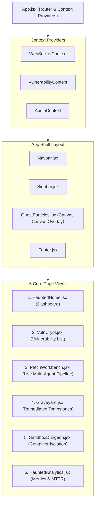
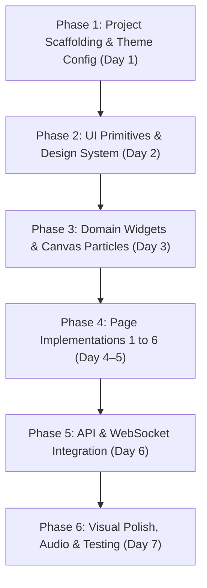

# PatchForge AI — Frontend Architecture & Working Flow Specification
**Document Version:** 1.0.0  
**Project:** PatchForge AI (Unified DevSecOps Self-Healing Remediation Engine)  
**Module:** Enterprise Web Operations Dashboard (`dashboard/`)  
**Design Philosophy:** "Cyber-Gothic DevSecOps" — Enterprise Precision meets High-Aesthetic Halloween Theme  

---

## 1. Executive UI/UX Design System & Theme Philosophy

The PatchForge AI dashboard balances **high-assurance enterprise DevSecOps monitoring** with a visually captivating **Halloween aesthetic**. Rather than looking like a toy novelty, it delivers a sleek, high-tech command center (reminiscent of Datadog or CrowdStrike) infused with a sophisticated dark-gothic palette, subtle neon glows, interactive skull severity indicators, bubbling cauldron telemetry gauges, and an interactive "Vulnerability Graveyard".

```
┌─────────────────────────────────────────────────────────────────────────────┐
│                    🎃 CYBER-GOTHIC DESIGN SYSTEM PALETTE                    │
├───────────────────┬───────────┬─────────────────────────────────────────────┤
│ Color Token       │ Hex Code  │ Semantic Application                        │
├───────────────────┼───────────┼─────────────────────────────────────────────┤
│ `midnight-black`  │ `#0a070f` │ Core app background, canvas base            │
│ `coffin-dark`     │ `#12091c` │ Secondary background, sidebar, navigation   │
│ `coffin-purple`   │ `#1d0e2e` │ Card containers, modals, table headers      │
│ `coffin-border`   │ `#3b1d5c` │ Glassmorphic card borders, dividers         │
│ `pumpkin-orange`  │ `#ff6a00` │ Primary action buttons, active states, glow │
│ `pumpkin-amber`   │ `#ff9d00` │ Hover states, warning highlights            │
│ `blood-red`       │ `#dc2626` │ Critical CVEs (5 skulls), test fail alerts  │
│ `ghost-green`     │ `#00ff9d` │ Remediated vulnerabilities, clean SAST scan │
│ `slime-lime`      │ `#39ff14` │ Terminal code output, active sockets        │
│ `cauldron-gold`   │ `#ffd700` │ Z3 invariant proofs, mutation scores        │
│ `bone-white`      │ `#f3e8ff` │ High-contrast primary typography            │
│ `crypt-gray`      │ `#9e8fb2` │ Secondary text, disabled states, timestamps │
└───────────────────┴───────────┴─────────────────────────────────────────────┘
```

### 1.1 Typography Hierarchy
- **Display / Headers:** `"Creepster", cursive` (used selectively for brand title, top hero stats, and graveyard tombstones).
- **Subheaders & Section Labels:** `"Cinzel Decorative", serif` or `"Rajdhani", sans-serif` (cyber-gothic tech feel).
- **Body & Data Grids:** `"Inter", sans-serif` (optimum enterprise readability, 400/500/600 weight).
- **Code, AST Diffs & Terminal:** `"JetBrains Mono", monospace` (ligatures enabled, clean indentation).

### 1.2 Elevation, Glassmorphism & Micro-Interactions
- **Glassmorphism Backdrop:** `backdrop-blur-md bg-opacity-70 bg-[#12091c] border border-[#3b1d5c]/60 shadow-[0_8px_32px_0_rgba(10,7,15,0.7)]`.
- **Pumpkin Glow Filter:** `drop-shadow(0 0 10px rgba(255, 106, 0, 0.45))`.
- **Spectral Green Glow Filter:** `drop-shadow(0 0 10px rgba(0, 255, 157, 0.45))`.
- **Blood Red Pulse:** `animate-pulse duration-1000 shadow-[0_0_15px_rgba(220,38,38,0.5)]`.
- **Card Hover Physics:** Smooth 3D tilt (`transform hover:-translate-y-1 hover:border-[#ff6a00]/80 transition-all duration-300 ease-out`).

---

## 2. Complete Frontend Directory & File Architecture

All frontend code lives under the `dashboard/` directory. Below is the production directory layout detailing **every single file** to be created.

```
dashboard/
├── public/
│   ├── favicon-pumpkin.ico          # 🎃 Custom glowing pumpkin browser favicon
│   ├── index.html                   # HTML entry point with Creepster/JetBrains fonts
│   ├── assets/
│   │   ├── textures/
│   │   │   ├── cobweb-corner.svg    # Transparent vector corner cobwebs
│   │   │   ├── graveyard-fog.png    # Seamless repeatable mist texture
│   │   │   └── stone-grunge.png     # Procedural tombstone stone texture
│   │   └── audio/
│   │       ├── eerie-ambient.mp3    # Subtle low-frequency cyber-gothic ambient drone
│   │       ├── cauldron-bubble.mp3  # Micro sound effect for tab hover/action
│   │       └── sword-slash.mp3      # Sound effect on patch synthesis approval
│   └── robots.txt
│
├── src/
│   ├── index.jsx                    # React 18 DOM mount point
│   ├── App.jsx                      # Main Layout Router with Framer Motion transitions
│   │
│   ├── theme/                       # Design System & Styling Tokens
│   │   ├── halloween.js             # JS tokens: hex colors, spacing, shadows, fonts
│   │   ├── animations.css           # Custom keyframes: float, candleFlicker, slimeDrip
│   │   └── index.css                # Tailwind imports + global scrollbar styling
│   │
│   ├── context/                     # Global State Management
│   │   ├── WebSocketContext.jsx     # Live bi-directional pipeline telemetry streaming
│   │   ├── VulnerabilityContext.jsx # Reactive store for findings, filters, and selections
│   │   └── AudioContext.jsx         # Ambient soundscape & SFX volume/mute toggle
│   │
│   ├── services/                    # API & Network Communications
│   │   ├── api.js                   # Axios client for FastAPI backend endpoints
│   │   ├── websocket.js             # WebSocket client with heartbeat & auto-reconnect
│   │   └── mockData.js              # High-fidelity fallback fixtures for standalone dev
│   │
│   ├── components/                  # Reusable UI Component Library
│   │   ├── layout/                  # Shell & Navigation Structure
│   │   │   ├── Navbar.jsx           # Top status bar: AWS connection, sound toggle, clock
│   │   │   ├── Sidebar.jsx          # Collapsible navigation with glowing iconography
│   │   │   ├── Footer.jsx           # Status ticker & GPG key signature verification badge
│   │   │   └── PageContainer.jsx    # Standardized wrapped layout with ambient fog canvas
│   │   │
│   │   ├── common/                  # Generic UI Primitives (Halloween-Styled)
│   │   │   ├── Button.jsx           # Spooky button: pumpkin-solid, blood-outline, ghost-ghost
│   │   │   ├── Card.jsx             # Glassmorphic container with cobweb corner accents
│   │   │   ├── Badge.jsx            # Severity badges (Critical, High, Medium, Neutralized)
│   │   │   ├── Modal.jsx            # Portal modal with dark overlay and coffin frame
│   │   │   ├── Tabs.jsx             # Tab switcher with glowing underline indicator
│   │   │   └── Tooltip.jsx          # Floating cyber-gothic tooltip box
│   │   │
│   │   ├── domain/                  # PatchForge-Specific Halloween Widgets
│   │   │   ├── SkullRating.jsx      # 1–5 animated skull severity indicator (💀)
│   │   │   ├── CauldronGauge.jsx    # Bubbling SVG potion gauge for CPU/RAM & Mutation
│   │   │   ├── TombstoneCard.jsx    # 3D stone tombstone for remediated CVEs (⚰️)
│   │   │   ├── PipelineNode.jsx     # Glowing state graph node with animated energy beam
│   │   │   ├── DiffViewer.jsx       # Monaco/Prism unified git diff viewer with line coloring
│   │   │   ├── TerminalLog.jsx      # Phosphor-green hacker CRT console with auto-scroll
│   │   │   ├── Z3ProofViewer.jsx    # LaTeX / First-Order Logic invariant formula display
│   │   │   └── GhostParticles.jsx   # Interactive HTML5 Canvas ambient spirits and bats
│   │
│   ├── pages/                       # 6 Core High-Fidelity Views
│   │   ├── HauntedHome.jsx          # 🏚️ Executive Command Center (Hero Stats & Ticker)
│   │   ├── VulnCrypt.jsx            # 💀 Active Vulnerability Vault (Filter, Triage, AST)
│   │   ├── PatchWorkbench.jsx       # 🔬 Real-Time Agent Synthesis & Sandbox Telemetry
│   │   ├── Graveyard.jsx            # ⚰️ Remediated Vulnerabilities Archive (Tombstones)
│   │   ├── SandboxDungeon.jsx       # 🧪 Hermetic Isolation Chamber & Mutation Monitor
│   │   └── HauntedAnalytics.jsx     # 📊 Cyber-Gothic Charts (MTTR Trends, AWS Cost/Latency)
│   │
│   └── utils/                       # Helper Utilities
│       ├── formatters.js            # Date, byte-size, and CWE string formatters
│       ├── severity.js              # CWE-to-skull-count and color mapping logic
│       └── soundEffects.js          # Audio playback trigger wrappers
│
├── package.json                     # React 18, Vite, Tailwind, Framer Motion, Lucide
├── tailwind.config.js               # Comprehensive Halloween theme extension
├── vite.config.js                   # Build configuration with backend proxying
└── postcss.config.js                # PostCSS plugins
```

---

## 3. Comprehensive Component Architecture & Props Specification



### 3.1 Domain Component Specifications

#### A. `SkullRating.jsx` (Severity Component)
- **Visual Design:** Displays 1 to 5 glowing skull icons (`💀`).
  - 1 Skull: Low (Ghostly Cyan `#00e5ff`)
  - 2 Skulls: Medium (Cauldron Amber `#ff9d00`)
  - 3 Skulls: High (Pumpkin Orange `#ff6a00`)
  - 4–5 Skulls: Critical (Blood Red `#dc2626` with pulsing flaming eyes effect)
- **Props:**
  ```typescript
  interface SkullRatingProps {
    count: number;          // 1 to 5
    max?: number;            // default 5
    interactive?: boolean;   // if true, acts as filter selector
    onChange?: (val: number) => void;
    size?: "sm" | "md" | "lg";
  }
  ```

#### B. `CauldronGauge.jsx` (Telemetry Widget)
- **Visual Design:** An authentic SVG-rendered iron cauldron with a bubbling liquid potion interior.
  - The potion fill level represents percentage (0% to 100%).
  - Liquid color transitions: Green (`#00ff9d`) for safe/normal, Orange (`#ff6a00`) for high load, Red (`#dc2626`) for quota warning.
  - Rising animated bubble particles (`keyframes: bubbleRise`).
- **Props:**
  ```typescript
  interface CauldronGaugeProps {
    value: number;          // 0 to 100
    label: string;          // e.g. "RAM Usage (2048MB)", "Mutation Score"
    metric: string;         // e.g. "92.4%", "1.4 GB"
    threshold?: number;     // e.g. 85 for mutation threshold
    colorScheme?: "green" | "orange" | "purple" | "blood";
  }
  ```

#### C. `TombstoneCard.jsx` (Archived Remediation Component)
- **Visual Design:** A realistic gothic tombstone carved out of cracked dark stone (`border-[#3b1d5c]`, stone texture background).
  - Top epitaph: `"R.I.P."` in Creepster font.
  - Body: CWE identifier (e.g., `CWE-89: SQL Injection in auth.py`), vulnerability death date, MTTR elapsed time.
  - Bottom: Embedded GitHub PR pill with green checkmark and "View Verification V-BOM" button.
  - 3D hover tilt with cobwebs appearing in the corner on hover.
- **Props:**
  ```typescript
  interface TombstoneCardProps {
    vulnerability: {
      id: string;
      cwe_id: string;
      title: string;
      file_path: string;
      resolved_at: string;
      mttr_seconds: number;
      pr_url: string;
      pr_number: number;
      mutation_score: number;
    };
    onInspectDiff: (id: string) => void;
  }
  ```

#### D. `PipelineNode.jsx` (Live Multi-Agent State Graph Node)
- **Visual Design:** Hexagonal or gothic-framed node representing a step in the LangGraph state machine (`SARIF Ingest`, `AST Slice`, `Z3 Solve`, `Agent Synthesize`, `Sandbox Verify`, `PR Dispatch`).
  - States: `IDLE` (faint purple outline), `ACTIVE` (bright pumpkin orange pulse with glowing energy beam traveling to next node), `PASSED` (ghost green with checkmark), `FAILED` (blood red with dripping blood CSS keyframe).
- **Props:**
  ```typescript
  interface PipelineNodeProps {
    title: string;
    stage: string;
    status: "idle" | "running" | "completed" | "failed";
    latencyMs?: number;
    agentName?: string;    // e.g. "Agent Alpha (Red Team)"
    icon: React.ReactNode;
    activeMessage?: string; // e.g. "Computing backward slice: 34 lines isolated"
  }
  ```

#### E. `DiffViewer.jsx` (Syntax-Highlighted Patch Viewer)
- **Visual Design:** Dark-themed side-by-side or unified code diff viewer with syntax highlighting.
  - Removed lines highlighted in deep blood red tint (`bg-red-950/40 text-red-300`).
  - Added lines highlighted in glowing ghost green tint (`bg-emerald-950/40 text-emerald-300`).
  - Line numbers in muted purple; AST node boundary tags displayed as hoverable badges.
- **Props:**
  ```typescript
  interface DiffViewerProps {
    diffContent: string;   // Git unified diff string
    language: string;      // "python" | "javascript" | "go"
    originalPath: string;
    newPath: string;
    astSliceRange?: [number, number];
  }
  ```

#### F. `GhostParticles.jsx` (Ambient Canvas Effect)
- **Visual Design:** Lightweight HTML5 Canvas component that spawns subtle, transparent floating ghost spirits (👻) and tiny bats (🦇) that drift slowly upwards in the background.
  - Ghosts react slightly to mouse cursor movement (repulsion effect).
  - Fully GPU-accelerated and throttled to 30fps to guarantee zero performance overhead on dev laptops.
  - Global toggle available in the navbar to pause or disable animations.

---

## 4. Page-by-Page Feature & Interaction Blueprints

### 4.1 Page 1: 🏚️ Haunted Home (Executive Command Center)
- **Header:** Animated graveyard hero banner with glowing full moon and live MTTR clock: `"Current Enterprise Exposure Window: 2m 45s (99.1% faster than industry baseline)"`.
- **Top Metric Cards (Cauldron Style):**
  1. **Active Curses (Open Vulnerabilities):** Total open findings with breakdown by skull count.
  2. **Spirits Exorcised (Remediated CVEs):** Total autonomous PRs successfully merged.
  3. **Cauldron Health (Sandbox Quota):** CPU/Memory utilization and container execution status.
  4. **AWS Bedrock Token Velocity:** Active token throughput and model inference latency.
- **Centerpiece Widget:** **"Live Curse Breaker"** quick-run widget:
  - Drag-and-drop area to upload a new SARIF report file directly from local disk.
  - One-click `"Summon PatchForge"` button with pumpkin particle explosion animation.
- **Activity Ticker:** Live stream of recent agent actions (e.g., `[15:42] Agent Beta synthesized 12-line patch for CWE-79 in server.js`).

---

### 4.2 Page 2: 💀 Vuln Crypt (Active Vulnerability Vault)
- **Layout:** High-density filterable data table with cyber-gothic borders.
- **Filter Controls:**
  - Search by file path or symbol name.
  - Severity filter by clicking Skull icons (1 to 5 skulls).
  - Scanner source tag buttons (`Semgrep`, `Bandit`, `Snyk`, `CodeQL`).
  - CWE category pills (`CWE-89: SQLi`, `CWE-22: Path Traversal`, `CWE-79: XSS`, `CWE-787: Buffer Overflow`).
- **Table Columns:**
  - `Severity`: Animated `<SkullRating count={v.skulls} />`
  - `Vulnerability`: CWE code + human-readable title
  - `Tainted Sink`: e.g. `cursor.execute(user_query)`
  - `File & Location`: `src/api/auth.py:42:12`
  - `Scanner`: Scanner logo badge + date detected
  - `Actions`: `"Dissect & Remediate"` button (navigates to Patch Workbench).
- **Interactive Drawer:** Clicking any row slides out a right-hand panel displaying the Tree-sitter AST preview, tainted variable call chain, and raw SARIF JSON snippet.

---

### 4.3 Page 3: 🔬 Patch Workbench (Live Multi-Agent Pipeline)
The core operational heart of the system.
- **Top Section:** **Animated State Machine Graph**
  - Six nodes: `SARIF Ingestion` ➔ `AST Slicing` ➔ `Z3 Solver` ➔ `Adversarial Loop` ➔ `Hermetic Sandbox` ➔ `PR Dispatch`.
  - Energy beam animates across connecting lines when active.
  - Current loop iteration badge: `Iteration k = 2 / 5` with flame indicator.
- **Main Split View (2 Columns):**
  - **Left Column (Live Code Diff & Invariant Proofs):**
    - Tab 1: **"AST Sliced Context"** — shows the isolated 35-line snippet extracted by Tree-sitter.
    - Tab 2: **"Candidate Patch Diff"** — live `<DiffViewer />` updating as Agent Beta writes patches.
    - Tab 3: **"Z3 Formal Invariants"** — First-Order Logic constraints formulated by Microsoft Z3 (`Assert: 0 <= offset < buffer_max`).
  - **Right Column (Terminal Log & Agent Duel Telemetry):**
    - Live phosphor-green CRT terminal (`<TerminalLog />`) receiving WebSocket events directly from the Python backend.
    - Real-time duel log showing Agent Alpha's PoC attack attempts vs. Agent Beta's patch defenses.
    - Terminal command prompt simulator: allows triggering manual re-runs or stepping through iterations.

---

### 4.4 Page 4: ⚰️ Graveyard (Remediated Vulnerabilities Archive)
- **Theme Concept:** A virtual cemetery commemorating every vulnerability that PatchForge has permanently neutralized.
- **Layout:** Grid of 3D stone `<TombstoneCard />` components.
- **Tombstone Visual:**
  - Engraved stone texture with cracked edges.
  - Cross/Skull engraved icon at the top with `"R.I.P."`.
  - CWE title and target repository path.
  - "Lifespan": Date discovered to date neutralized.
  - "Cause of Death": Type of fix applied (e.g., *Parameterization*, *Bounds Validation*, *Safe Deserialization*).
- **Search & Sort:** Search by CVE/CWE, sort by "Date of Death" or "MTTR Speed".
- **Inspection Modal:** Clicking any tombstone opens the complete **Cryptographic Verification Bill of Materials (V-BOM)**:
  - Original SARIF finding snapshot.
  - Z3 formal verification certificate.
  - Sandbox execution logs showing 100% unit tests passed + reproduction test blocked.
  - Mutation testing score badge (e.g., `92.4% Mutants Killed`).
  - Direct link to the merged GPG-signed Pull Request.

---

### 4.5 Page 5: 🧪 Sandbox Dungeon (Hermetic Isolation Chamber)
- **Theme Concept:** A fortified, underground subterranean chamber where untrusted AI-generated code is executed safely under tight lock and key.
- **Top Gauge Cluster:**
  - `<CauldronGauge value={cpuPercent} label="CPU Allotted" metric="1.8 / 2.0 Cores" />`
  - `<CauldronGauge value={ramPercent} label="Memory Limit" metric="1420 / 2048 MB" />`
  - `<CauldronGauge value={mutationScore} label="Mutation Score" metric="91.2%" threshold={85} />`
- **Isolation Status Badges:**
  - 🌐 **Air-Gap Verification:** `[NETWORK: NONE]` (Glowing Ghost Green with shield icon).
  - 🛡️ **Privilege Mode:** `[ROOTLESS: UID 1001]` (Active).
  - 🔒 **File System:** `[ROOTFS: READ-ONLY]` (Mounted with tmpfs).
  - ⏱️ **Watchdog Timer:** `[HARD TIMEOUT: 60s]` (Hardware timer).
- **Live Stream Window:** Tabbed terminal showing live execution of:
  1. `pytest` unit & regression test suite.
  2. Dynamic security reproduction exploit test.
  3. `mutmut` AST mutant generation and kill-rate telemetry.
  4. Delta-SAST re-scan output confirming zero alerts.

---

### 4.6 Page 6: 📊 Haunted Analytics (Cyber-Gothic Telemetry)
- **Dark-Themed Analytical Charts:**
  1. **MTTR Exorcism Curve (Area Chart):** Compares manual enterprise MTTR (45–120 days) against PatchForge's automated remediation timeline (< 3 minutes).
  2. **Vulnerability Burn-Down (Bar Chart):** Weekly count of vulnerabilities discovered vs. automatically dispatched to PRs.
  3. **Mutation Kill Rate Distribution (Radar Chart):** Demonstrates code coverage across arithmetic, conditional, and boundary mutation operators.
  4. **AWS Infrastructure Telemetry (Line Charts):**
     - Amazon Bedrock token consumption & inference latency per patch.
     - Amazon S3 artifact storage velocity.
     - Amazon DynamoDB audit query latency.

---

## 5. State Management & Real-Time Data Flow

```
FastAPI Server (Port 8000)
    │
    ├── REST API (/api/vulns, /api/dashboard, /api/runs)
    └── WebSocket (/ws/pipeline)
            │
            ▼
React Frontend (Port 5173)
    │
    ├── WebSocketContext (Central Event Bus)
    │       ├── Message: "NODE_START"   ➔ Updates PipelineNode active state
    │       ├── Message: "LOG_STREAM"   ➔ Appends stdout to TerminalLog
    │       ├── Message: "DIFF_READY"   ➔ Updates DiffViewer
    │       └── Message: "RUN_COMPLETE" ➔ Triggers confetti & plays victory chime
    │
    └── VulnerabilityContext (Local Cache & Filters)
```

### 5.1 WebSocket Protocol Schema (`/ws/pipeline`)
All real-time telemetry flows as JSON messages over the WebSocket connection:

```typescript
// Incoming WebSocket Event Frame
interface PipelineEvent {
  event_type: "NODE_TRANSITION" | "LOG_OUTPUT" | "DIFF_UPDATE" | "INVARIANT_UPDATE" | "PIPELINE_COMPLETE" | "PIPELINE_ERROR";
  timestamp: string;
  run_id: string;
  payload: {
    current_node?: string;       // e.g. "synthesize_patch"
    status?: "running" | "completed" | "failed";
    log_line?: string;           // ANSI-formatted stdout/stderr line
    patch_diff?: string;         // Unified diff content
    invariants?: string[];       // Z3 invariant formulas
    iteration?: number;          // Current loop iteration k
    mutation_score?: number;     // e.g. 92.5
    pr_url?: string;             // Published PR URL
    error_message?: string;
  };
}
```

---

## 6. Step-by-Step Frontend Implementation Working Flow

The following 6-phase development roadmap defines the step-by-step order of operations for Member 2 to construct the complete frontend cleanly and without regressions.



### Phase 1: Project Scaffolding & Theme Setup (Day 1)
1. Initialize Vite project with React 18: `npm create vite@latest dashboard -- --template react`.
2. Install core production dependencies:
   ```bash
   cd dashboard
   npm install tailwindcss postcss autoprefixer framer-motion lucide-react recharts axios
   npm install -D @tailwindcss/typography tailwind-scrollbar
   ```
3. Initialize Tailwind and configure `tailwind.config.js` with the complete Halloween color palette (`midnight-black`, `coffin-purple`, `pumpkin-orange`, `blood-red`, `ghost-green`).
4. Set up `public/index.html` importing Google Fonts (`Creepster`, `JetBrains Mono`, `Inter`).
5. Configure `vite.config.js` with a proxy to the FastAPI backend (`http://localhost:8000`).

### Phase 2: Core UI Primitives & Layout Shell (Day 2)
1. Build `src/theme/halloween.js` (color and spacing tokens).
2. Build `src/theme/animations.css` (CSS keyframes for glowing pulses, ghost floats, dripping blood).
3. Create generic components:
   - `src/components/common/Button.jsx` (with glowing pumpkin/blood hover states).
   - `src/components/common/Card.jsx` (glassmorphic coffin-purple cards with border highlights).
   - `src/components/common/Badge.jsx` (severity badges).
   - `src/components/common/Modal.jsx` (accessible dialog with dark backdrop blur).
4. Create app layout shell:
   - `src/components/layout/Navbar.jsx` (status bar, AWS indicator, clock, audio toggle).
   - `src/components/layout/Sidebar.jsx` (glowing navigation items, pumpkin brand badge).
   - `src/components/layout/Footer.jsx`.

### Phase 3: Halloween Domain Widgets & Effects (Day 3)
1. Build `src/components/domain/GhostParticles.jsx` (HTML5 Canvas ambient spirits drifting upwards).
2. Build `src/components/domain/SkullRating.jsx` (1–5 skulls with flaming red eyes on 5 skulls).
3. Build `src/components/domain/CauldronGauge.jsx` (SVG bubbling potion gauge for CPU/RAM and mutation score).
4. Build `src/components/domain/TombstoneCard.jsx` (3D stone card with R.I.P. header and PR button).
5. Build `src/components/domain/PipelineNode.jsx` (state machine visualizer node).
6. Build `src/components/domain/TerminalLog.jsx` (CRT phosphor-green terminal with auto-scroll).
7. Build `src/components/domain/DiffViewer.jsx` (syntax-highlighted unified patch viewer).

### Phase 4: Page Implementations (Day 4–5)
1. **Day 4 Morning:** Build `src/pages/HauntedHome.jsx` (Command center, hero graveyard banner, quick-run SARIF upload).
2. **Day 4 Afternoon:** Build `src/pages/VulnCrypt.jsx` (Filterable vulnerability table with skull ratings and inspection drawer).
3. **Day 5 Morning:** Build `src/pages/PatchWorkbench.jsx` (Split-screen live multi-agent synthesis, live diff, Z3 invariant inspector).
4. **Day 5 Afternoon:** Build `src/pages/Graveyard.jsx` (Tombstone grid, V-BOM proof modal), `src/pages/SandboxDungeon.jsx` (container telemetry, cauldrons), and `src/pages/HauntedAnalytics.jsx` (dark-themed Recharts graphs).

### Phase 5: Network Layer & Real-Time WebSocket Hookup (Day 6)
1. Build `src/services/api.js` with endpoints matching FastAPI routes (`/api/dashboard`, `/api/vulns`, `/api/runs`).
2. Build `src/services/websocket.js` and `src/context/WebSocketContext.jsx`:
   - Auto-connects to `ws://localhost:8000/ws/pipeline`.
   - Handles ping/pong heartbeats and exponential backoff on disconnect.
3. Wire live WebSocket frames into `PatchWorkbench.jsx` and `SandboxDungeon.jsx` to render live streaming logs and node state transitions.
4. Provide `src/services/mockData.js` so the frontend can be run and tested in 100% standalone mode without waiting for the backend.

### Phase 6: Micro-Interactions, Audio, Responsiveness & Polish (Day 7)
1. Implement `src/context/AudioContext.jsx` with optional ambient audio (muted by default, toggled via Navbar icon).
2. Add sound effect cues: subtle bubble pop on button click, eerie bell toll when a vulnerability is neutralized.
3. Verify mobile and wide-screen responsiveness (Tailwind `sm`, `md`, `lg`, `xl`, `2xl` breakpoints).
4. Verify accessibility: ensure text on coffin-purple backgrounds passes WCAG AA contrast standards (minimum 4.5:1 ratio).
5. Run production build: `npm run build` and ensure zero build warnings or chunk bloat.

---

## 7. Sample Core Component Implementation Reference

### 7.1 `SkullRating.jsx`
```jsx
import React from 'react';
import { Skull } from 'lucide-react';

export const SkullRating = ({ count = 1, max = 5, size = "md", interactive = false, onChange }) => {
  const sizeClasses = {
    sm: "w-4 h-4",
    md: "w-5 h-5",
    lg: "w-6 h-6",
  };

  const getSkullColor = (index) => {
    if (index >= count) return "text-[#3b1d5c] opacity-40";
    if (count === 5) return "text-red-500 drop-shadow-[0_0_8px_rgba(239,68,68,0.8)] animate-pulse";
    if (count >= 4) return "text-orange-500 drop-shadow-[0_0_6px_rgba(249,115,22,0.6)]";
    if (count >= 3) return "text-amber-400 drop-shadow-[0_0_4px_rgba(251,191,36,0.5)]";
    return "text-cyan-400";
  };

  return (
    <div className="flex items-center gap-1" title={`Severity: ${count} of ${max} skulls`}>
      {Array.from({ length: max }).map((_, i) => (
        <button
          key={i}
          type="button"
          disabled={!interactive}
          onClick={() => interactive && onChange && onChange(i + 1)}
          className={`transition-transform duration-200 ${interactive ? 'hover:scale-125 cursor-pointer' : 'cursor-default'}`}
        >
          <Skull className={`${sizeClasses[size]} ${getSkullColor(i)}`} />
        </button>
      ))}
      <span className="ml-1 text-xs font-mono text-[#9e8fb2]">({count}/{max})</span>
    </div>
  );
};
```

### 7.2 `TombstoneCard.jsx`
```jsx
import React from 'react';
import { GitPullRequest, ShieldCheck, Clock } from 'lucide-react';

export const TombstoneCard = ({ vulnerability, onInspectDiff }) => {
  const { cwe_id, title, file_path, resolved_at, mttr_seconds, pr_url, pr_number, mutation_score } = vulnerability;

  return (
    <div className="relative group bg-[#160c22] border-2 border-[#3b1d5c] hover:border-[#ff6a00] rounded-t-3xl rounded-b-lg p-5 shadow-2xl transition-all duration-300 transform hover:-translate-y-2 hover:shadow-[0_15px_30px_rgba(255,106,0,0.25)] flex flex-col justify-between">
      {/* Stone Arch Top Header */}
      <div className="text-center border-b border-[#3b1d5c]/60 pb-3 mb-3">
        <span className="font-['Creepster'] text-2xl tracking-widest text-[#ff6a00] drop-shadow-[0_0_6px_rgba(255,106,0,0.6)]">
          R. I. P.
        </span>
        <div className="text-xs font-mono text-[#9e8fb2] uppercase tracking-wider mt-1">Neutralized Threat</div>
      </div>

      {/* Epitaph Body */}
      <div className="space-y-2 my-2">
        <div className="inline-block px-2 py-0.5 rounded text-xs font-bold font-mono bg-red-950/60 text-red-400 border border-red-800/40">
          {cwe_id}
        </div>
        <h4 className="text-sm font-semibold text-[#f3e8ff] leading-snug group-hover:text-[#ff9d00] transition-colors">
          {title}
        </h4>
        <p className="text-xs font-mono text-[#9e8fb2] truncate" title={file_path}>
          📍 {file_path}
        </p>
      </div>

      {/* Verification Metrics */}
      <div className="grid grid-cols-2 gap-2 my-3 pt-3 border-t border-[#3b1d5c]/40 text-xs font-mono">
        <div className="flex items-center gap-1.5 text-[#00ff9d]">
          <ShieldCheck className="w-3.5 h-3.5" />
          <span>{mutation_score}% Killed</span>
        </div>
        <div className="flex items-center gap-1.5 text-[#ffd700]">
          <Clock className="w-3.5 h-3.5" />
          <span>{Math.round(mttr_seconds)}s MTTR</span>
        </div>
      </div>

      {/* Action Footer */}
      <div className="flex items-center justify-between gap-2 pt-2">
        <a
          href={pr_url}
          target="_blank"
          rel="noreferrer"
          className="flex-1 flex items-center justify-center gap-1.5 bg-[#25133b] hover:bg-[#ff6a00] hover:text-black text-xs font-semibold py-1.5 px-3 rounded text-[#f3e8ff] border border-[#4d2875] hover:border-[#ff6a00] transition-colors"
        >
          <GitPullRequest className="w-3.5 h-3.5" />
          <span>PR #{pr_number}</span>
        </a>
        <button
          onClick={() => onInspectDiff(vulnerability.id)}
          className="px-3 py-1.5 bg-[#120720] hover:bg-[#3b1d5c] text-xs font-mono text-[#9e8fb2] hover:text-[#f3e8ff] rounded border border-[#3b1d5c] transition-colors"
        >
          Proofs
        </button>
      </div>
    </div>
  );
};
```

---

## 8. Verification & Acceptance Checklist

Before handing off the frontend for complete end-to-end integration:

- [ ] `npm run build` generates clean production bundles without warnings or missing CSS imports.
- [ ] Halloween theme tokens correctly style all 6 pages (`midnight-black`, `coffin-purple`, `pumpkin-orange`).
- [ ] Creepster, JetBrains Mono, and Inter fonts load seamlessly from local/Google Fonts.
- [ ] `<GhostParticles />` canvas runs smoothly at 30–60 FPS without leaking memory on unmount.
- [ ] WebSocket client automatically recovers from disconnects with exponential retry logic.
- [ ] Fallback fixtures (`mockData.js`) allow testing all views completely decoupled from the FastAPI backend.
- [ ] All table filters (skull rating, scanner type, search query) operate with zero latency.
- [ ] `<TombstoneCard />` cards properly render live PR links and verification scores.
- [ ] `<CauldronGauge />` dynamically updates liquid fill and bubble animation according to props.

